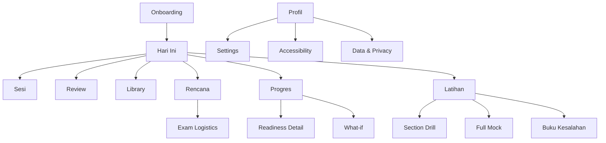
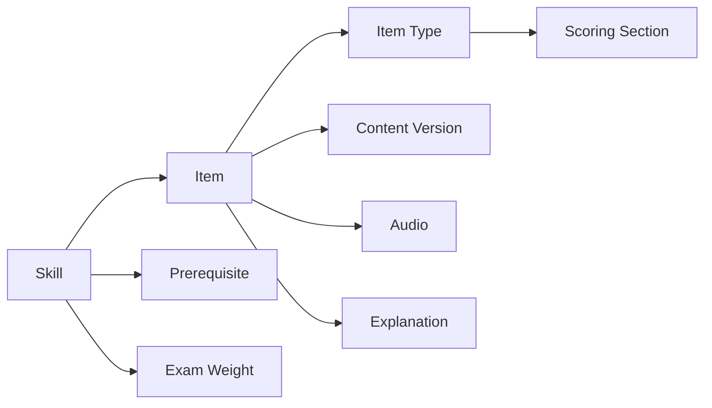
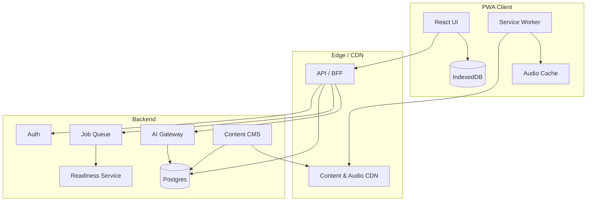
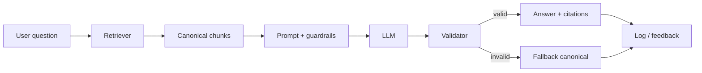

# DESIGN — N4 Pilot

**Calm confidence at the moment of study.**

| Item | Keterangan |
|---|---|
| Versi | 2.0 |
| Tanggal | 25 Oktober 2026 |
| Pemilik | Product Design |
| Status | Draft untuk prototyping & usability test |
| Dokumen terkait | `PRD.md` |
| Platform | PWA mobile-first; wrapper iOS/Android setelah validasi |
| Bahasa | Bahasa Indonesia + Jepang |
| Stage | Pre-build; perlu validasi 5–8 pengguna per iterasi |

---

## 0. Design Thesis

Pelajar N4 dari nol tidak kekurangan aplikasi. Mereka kekurangan **rasa jelas**:

- “Apa yang harus aku lakukan sekarang?”
- “Apakah aku benar-benar maju?”
- “Apakah aku akan lulus?”
- “Kalau aku bolos, apakah semuanya hancur?”

N4 Pilot harus terasa seperti **mentor yang tenang dan terpercaya**, bukan cockpit dengan 40 tombol. Tujuan desain bukan membuat belajar terasa mudah — belajar memang sulit — tetapi membuat **langkah berikutnya terasa jelas, jujur, dan bisa dilakukan**.

### Design outcomes

1. Dalam **60 detik**, pengguna paham rencananya dan apa yang harus dilakukan hari ini.
2. Dalam **10 menit**, pengguna menyelesaikan sesi pertama dan melihat bukti kemajuan.
3. Dalam **1 mock**, pengguna paham di mana posisinya — tanpa merasa dihakimi.
4. Setelah **bolos 3 hari**, pengguna bisa kembali dalam 10 menit tanpa tumpukan review.
5. Pengguna bisa **menjelaskan readiness-nya sendiri**: skor, rentang, gate, dan bukti.

### North Star experience

> **“Aku tahu apa yang harus kulakukan, aku tahu kenapa, dan aku percaya angka yang kubaca.”**

### Design metrics

| Metrik | Target |
|---|---:|
| Time to first value (onboarding → first session complete) | <10 menit |
| Time to start session from app open | <15 detik |
| First-session completion | ≥75% |
| Plan comprehension (usability test) | ≥80% |
| Readiness comprehension (range + gate + evidence) | ≥80% |
| Recovery session completion after 3+ missed days | ≥50% |
| Mock completion among eligible learners | ≥50% |
| Critical accessibility issues | 0 |
| Session crash rate | <0.5% |

---

## 1. Experience Principles

1. **Answer “what now?” in three seconds.**  
   Setiap layar punya satu aksi utama. Jika ada dua hal penting, salah satunya menjadi secondary.

2. **Show proof, not applause.**  
   Kami tidak merayakan XP. Kami menunjukkan “kamu bisa membaca 12 kata baru di teks ini” atau “listening quick response naik 8 poin”.

3. **Make the exam visible without panic.**  
   Countdown boleh ada, tetapi tidak mendominasi. “±13 bulan” bukan alarm; itu konteks.

4. **One primary action.**  
   Home: “Mulai sesi”. Mock: “Mulai mock”. Readiness: “Perbaiki fokus”. Tidak ada dua CTA besar yang bersaing.

5. **Respect cognitive load.**  
   Satu konsep per layar, chunking, contoh dahulu, baru latihan. Tidak ada dinding teks.

6. **Recovery over punishment.**  
   Setelah bolos, pengguna melihat “rencana sudah dirapikan”, bukan “kamu gagal 3 hari”.

7. **Calm, adult, local.**  
   Bahasa Indonesia natural, tidak kekanak-kanakan. Tidak ada maskot anime, sakura, atau gamifikasi yang mempermalukan.

8. **Accessible by default.**  
   Kontras, ukuran sentuh, screen reader, transkrip, dan mode offline bukan fitur tambahan.

9. **AI in the margin, not the hero.**  
   AI muncul saat pengguna bertanya “kenapa?”; bukan menggantikan kurikulum atau menjadi wajah produk.

10. **Delight in the language, not in confetti.**  
    Kejutan kecil: contoh kalimat yang lucu, fakta budaya, momen “oh, ternyata polanya begitu”. Bukan ledakan animasi.

---

## 2. Users & Context

### 2.1 Primary context — “Rani di commuter”

- **Waktu:** 07.10, commuter Jakarta, 45 menit, satu tangan memegang pegangan.
- **Perangkat:** Android mid-range 2 GB RAM, 4G tidak stabil, earphone.
- **Emosi:** sedikit cemas, ingin merasa produktif, takut ketinggalan.
- **Yang dia butuhkan:** satu tombol mulai, audio yang sudah siap, sesi yang bisa dijeda, tidak perlu mengetik panjang.
- **Yang membuat dia berhenti:** layar penuh pilihan, teks panjang, audio buffering, timer yang menghakimi.

### 2.2 Emotional states

| State | Yang pengguna pikirkan | Desain harus |
|---|---|---|
| **Overwhelmed** | “Terlalu banyak yang harus dipelajari.” | Menyembunyikan kompleksitas; satu langkah. |
| **Guilty** | “Aku sudah bolos 3 hari.” | Recovery, bukan hukuman. |
| **Anxious** | “Mock besok. Aku belum siap.” | Rencana konkret, bukan reassurance kosong. |
| **Proud** | “Aku bisa baca ini!” | Bukti yang spesifik, bukan badge. |
| **Skeptical** | “Apakah angka ini benar?” | Rentang, bukti, dan “kenapa”. |
| **Tired** | “Aku cuma punya 10 menit.” | Quick 10 yang benar-benar berarti. |

### 2.3 Device & environment constraints

- Layar 360–430 px; safe area; bottom nav.
- Audio harus preload; transkrip sebagai fallback.
- Offline untuk review dan konten yang sudah diunduh.
- Low-data mode: audio 64 kbps mono; gambar WebP/AVIF.
- Tidak mengandalkan hover; semua aksi bisa tap.
- Text scaling 200%; layout tidak boleh rusak.
- Getaran/suara opsional; default halus.

---

## 3. Information Architecture

### 3.1 Navigation model

Lima tab utama:

1. **Hari Ini** — apa yang harus dilakukan sekarang.
2. **Rencana** — timeline, kalender, fase, mock, recovery.
3. **Latihan** — section drill, full mock, error notebook, test strategy.
4. **Progres** — readiness, coverage, retention, what-if.
5. **Profil** — goal, preferensi, aksesibilitas, langganan, data.

Library (kana, vocab, kanji, grammar, reading, listening) tidak menjadi tab; diakses dari Home, pencarian, dan link dalam sesi. Ini mengurangi kepadatan navigasi.



### 3.2 URL / route map

| Route | Screen | Catatan |
|---|---|---|
| `/onboarding` | Onboarding flow | Guest mode; no auth until value. |
| `/today` | Home | Default setelah onboarding. |
| `/session/:id` | Session player | Full-screen; no bottom nav. |
| `/review` | Review queue | Bisa dari Home. |
| `/library` | Search & browse | Kana, vocab, kanji, grammar. |
| `/library/:type/:id` | Detail item | Deep link. |
| `/plan` | Plan | Timeline & calendar. |
| `/practice` | Practice hub | Drill, mock, error notebook. |
| `/mock/:id` | Mock runner | Full-screen; timer. |
| `/mock/:id/report` | Score report | Setelah submit. |
| `/progress` | Readiness | Default progress. |
| `/progress/what-if` | Simulator | Sheet atau halaman. |
| `/errors` | Buku kesalahan | Filter & fix-it. |
| `/profile` | Profil | Settings. |
| `/exam` | Exam logistics | Checklist & official links. |

### 3.3 Content hierarchy

- **Home** hanya menampilkan 3 hal di atas fold: status ujian, readiness, sesi hari ini.
- **Detail** selalu bisa dibuka tanpa kehilangan posisi sesi.
- **Search** global untuk kata/kanji/grammar; hasil mengarah ke detail dan “tambahkan ke review”.
- **Deep link** ke item mempertahankan konteks asal (sesi, reading, mock report).

---

## 4. Core Journeys

### 4.1 Journey A — First 10 minutes

**Tujuan:** dari “aku belum tahu apa-apa” menjadi “aku punya rencana dan sudah mulai”.

| Langkah | Layar | Yang pengguna lihat | Keputusan |
|---|---|---|---|
| 1 | Welcome | “Kita akan mulai dari nol. Tanpa tes awal yang bikin takut.” | Mulai |
| 2 | Starting point | 4 kartu: dari nol / kenal kana / pernah belajar / punya skor mock. | Pilih |
| 3 | Exam date | Juli 2027 (perkiraan), Des 2027 (perkiraan), custom. Disclaimer tanggal resmi. | Pilih |
| 4 | Time budget | Slider jam/hari + hari/minggu; total jam/minggu. | Atur |
| 5 | Reality check | Perbandingan target vs waktu; 3 opsi. | Pilih opsi |
| 6 | Plan preview | Timeline fase, mock dates, minggu pertama. | Lihat |
| 7 | First session | 3 kana + 3 kata + 1 listening; 5–10 menit. | Selesaikan |
| 8 | Save | “Simpan progres?” email/Google/Apple. | Daftar |

**Aturan:**

- Maksimal **4 keputusan** sebelum sesi pertama.
- Tidak ada paywall sebelum sesi pertama selesai.
- Tidak ada diagnostic panjang untuk absolute beginner.
- Jika pengguna memilih tanggal yang tidak realistis, reality check muncul **setelah** mereka melihat plan preview singkat — bukan sebagai tembok pertama.

**Success signal:** pengguna bisa mengetuk “Mulai sesi” dari Home tanpa bantuan; first-session completion ≥75%.

### 4.2 Journey B — Daily 45 minutes

1. **Buka app** → Home.
2. **Lihat status** → “Di jalur; listening masih 62%.”
3. **Tap “Mulai sesi”** → session player.
4. **Review** 12 kartu → feedback singkat.
5. **Learn** 1 grammar point → worked example → 2 checks.
6. **Apply** 1 reading/listening task → feedback.
7. **Recap** → 3 bullet + next review + “fokus besok”.
8. **Kembali ke Home** → readiness card diperbarui dengan animasi halus.

**Target:** 45 ± 5 menit; tidak ada iklan; bisa pause di mana saja; resume <1 detik.

### 4.3 Journey C — Missed 3 days (Recovery)

1. Buka app → banner: “Kamu absen 3 hari. Aku sudah rapikan rencananya — tidak ada tumpukan.”
2. Home menampilkan **Quick 10** sebagai CTA utama, bukan sesi 90 menit.
3. Session: 6 review + 2 input + 2 listening.
4. Recap: “Kamu kembali. Besok kita lanjut pelan-pelan.”
5. Plan: new item cap diturunkan 50% selama 3 hari; overdue review disebar.

**Yang tidak boleh terjadi:**

- “Kamu punya 487 review.”
- “Streak hilang.”
- “Kamu mengecewakan dirimu.”
- Mock langsung dijadwalkan pada hari kembali.

### 4.4 Journey D — First full mock

1. Practice → Full Mock → overview.
2. Overview: 3 sections, time, rules, “pause hanya antar-seksi”, “audio sekali”.
3. Section 1: Vocabulary 25 menit.
4. Break 10 menit (opsional; timer berhenti).
5. Section 2: Grammar/Reading 55 menit.
6. Break 10 menit.
7. Section 3: Listening 35 menit.
8. Submit → “Menganalisis…” (progress).
9. Score report: estimasi + range, gates, 3 wins, 3 leaks, next 7 days.
10. “Lihat pembahasan” → item review; error taxonomy; “Fix-it 10 menit”.

**Emotional design:** hasil tidak boleh terasa seperti vonis. Gunakan “Ini data, bukan label.” Jika gagal gate, tampilkan “Ini yang paling menaikkan peluangmu minggu ini”, bukan “kamu gagal”.

### 4.5 Journey E — Exam week

1. Home berubah menjadi **Taper Mode**.
2. Tidak ada materi baru; hanya review high-yield, 1 section ringan, dan istirahat.
3. Checklist logistik: kartu ujian, identitas, lokasi, transport, jam datang.
4. Copy: “Tidak ada yang bisa kamu tambah minggu ini. Yang bisa kamu lakukan: tidur, review ringan, dan datang tepat waktu.”
5. Hari ujian: mode “Exam day” — hanya checklist dan doa; tidak ada konten baru.

### 4.6 Journey F — Upgrade

1. Setelah mock pertama atau setelah 3 sesi.
2. Paywall sheet: “Kamu sudah melihat gap-nya. Plus membuka full mock, listening lab, dan offline.”
3. Tampilkan harga lokal, benefit konkret, dan “tidak sekarang”.
4. Tidak ada paywall di tengah sesi; tidak ada countdown palsu.

---

## 5. Screen Specifications

### 5.1 Onboarding

**Purpose:** menetapkan goal yang realistis dan memulai sesi pertama dengan cepat.

**Hierarchy:**

1. Satu pertanyaan per layar.
2. Progress indicator 1–5.
3. Back selalu tersedia.
4. “Kenapa kami bertanya?” dalam bottom sheet opsional.

**Screen 1 — Starting point**

- Headline: “Kamu mulai dari mana?”
- Cards:
  - “Dari nol” — “Belum kenal hiragana/katakana.”
  - “Sudah kenal kana” — “Bisa baca, belum belajar grammar.”
  - “Pernah belajar sedikit” — “Punya fondasi N5.”
  - “Punya skor mock” — “Mau kalibrasi.”
- CTA: “Lanjut”.

**Screen 2 — Exam date**

- Headline: “Kapan kamu ingin ujian?”
- Cards:
  - “Juli 2027” — label “perkiraan; menunggu pengumuman resmi”.
  - “Desember 2027” — label “perkiraan; lebih realistis untuk 2 jam/hari”.
  - “Tanggal lain” — date picker.
- Microcopy: “Kami tidak bisa menjamin tanggal 2027 sampai JLPT mengumumkannya. Kamu bisa ubah nanti.”
- CTA: “Lanjut”.

**Screen 3 — Time budget**

- Headline: “Berapa waktu yang benar-benar kamu punya?”
- Slider jam/hari: 0,5–5, step 0,25.
- Day selector: 3–7 hari.
- Dynamic total: “13,5 jam/minggu”.
- Microcopy: “Jujur lebih penting daripada ambisius. Rencana bisa diubah.”
- CTA: “Lihat rencanaku”.

**Screen 4 — Reality check**

- Headline: “Ini matematikanya.”
- Two-column comparison:
  - “Target 700 jam” vs “Waktumu 468 jam”.
  - “Dengan 1,5 jam × 6 hari, kamu butuh 15–26 bulan.”
- Options:
  1. “Tambah jadi 2,25 jam/hari” — plan 12 bulan.
  2. “Geser ujian ke Desember 2027” — plan 13–14 bulan.
  3. “Lanjut sprint” — “Risiko tinggi; kami akan menandai ini.”
- CTA: “Lihat rencana yang cocok”.

**Screen 5 — Plan preview**

- Phase timeline: Foundations → N5 Bridge → N4 Core → Integration → Mock → Taper.
- “3 full mock + 1 checkpoint” dates.
- “Minggu pertama: kana + 20 kata + 2 listening.”
- CTA: “Mulai 10 menit pertama”.

**Screen 6 — First session**

- 3 kana + 3 kata + 1 listening.
- End: “Kamu sudah bisa membaca 3 karakter dan 3 kata. Besok kita tambah 5.”
- CTA: “Simpan progres”.

**Acceptance criteria**

- Semua layar bisa diselesaikan dengan satu tangan.
- Reality check muncul <1 detik setelah slider berubah.
- Tanggal 2027 selalu berlabel “perkiraan”.
- Tidak ada kata “gagal” di onboarding.
- First session selesai <10 menit.

---

### 5.2 Home — “Hari Ini”

**Purpose:** menjawab “apa yang harus aku lakukan sekarang?” dalam <3 detik.

**Hierarchy (above the fold):**

1. **Exam context** — “Menuju Des 2027 (est.) · ±13 bulan” (small, not dominant).
2. **Readiness card** — status + range + gates.
3. **Today’s session** — time estimate + CTA.
4. **Focus** — 1–3 item paling berdampak.
5. **Evidence** — satu bukti kemajuan.
6. **Plan snippet** — 7 hari ke depan.

**Wireframe**

```text
+------------------------------------------+
| N4 Pilot        Des 2027 (est.) · 13 bln |
|------------------------------------------|
| KESIAPAN                     [ Kenapa? ] |
| Di jalur          96-112 / 180           |
| K+R 68-80/120     Listening 28-32/60     |
| [======== range bar ========]            |
| Bukti: 2 mock · coverage 81%             |
|------------------------------------------|
| HARI INI · 45 menit                      |
| 12 review · 1 grammar · 1 listening      |
| [ Mulai sesi ]          [ Quick 10 ]     |
|------------------------------------------|
| FOKUS                                     |
| Quick response 62% · に/で · reading speed|
| [ Latih 10 menit ]                       |
|------------------------------------------|
| BUKTI TERBARU                             |
| Kamu membaca 18 kata baru di teks ini.   |
+------------------------------------------+
| Hari Ini  Rencana  Latihan  Progres  Profil |
+------------------------------------------+
```

**Copy rules:**

- Status: “Belum cukup data”, “Berisiko”, “Di jalur”, “Aman”.
- Jangan tampilkan “87,3%” — tampilkan rentang.
- Jika gate di bawah: “Listening belum aman” dengan ikon warning, bukan merah menyala.
- Jika belum ada data: “Kami belum punya cukup bukti. Mulai sesi pertama atau ambil 1 mock.”

**States**

| State | Tampilan |
|---|---|
| **New user** | Readiness kosong; CTA “Mulai 10 menit pertama”; copy “Kami akan mengukur setelah kamu selesai.” |
| **Active** | Readiness + sesi + fokus + bukti. |
| **At risk** | Banner amber: “Listening 17–22/60. Gate belum aman. Fokus minggu ini: quick response.” |
| **Mock due** | Card “Mock 2 sudah waktunya” dengan CTA “Mulai mock”; secondary “Nanti”. |
| **Recovery** | Banner netral: “Kamu absen 3 hari. Rencana sudah dirapikan.” CTA “Quick 10”. |
| **Exam week** | Taper mode: “Tidak ada materi baru”; checklist logistik. |
| **Offline** | Banner abu: “Mode offline. Progres tersimpan dan akan disinkronkan.” |

**Acceptance**

- CTA “Mulai sesi” terlihat tanpa scroll pada 360×640.
- Readiness range dan gate terbaca dalam <5 detik (usability test).
- Tidak ada lebih dari 3 kartu di atas fold.
- Home load <1 detik dari cache.

---

### 5.3 Session Player

**Purpose:** menjaga fokus, memberi feedback, dan menyelesaikan sesi tanpa keputusan yang tidak perlu.

**Layout**

- Header: back, block progress, timer, pause.
- Content: satu kartu per layar.
- Footer: CTA utama; secondary “Kenapa?” atau “Laporkan”.
- Tidak ada bottom nav.

**Block types**

1. **Recall** — pertanyaan singkat dari item sebelumnya.
2. **Review** — SRS card; jawaban; rating.
3. **Learn** — konsep baru; contoh; 1–2 checks.
4. **Apply** — reading/listening/grammar task.
5. **Prove** — timed mini-set.
6. **Recap** — 3 bullet + next review.

**Wireframe — review card**

```text
+------------------------------------------+
| <-   Blok 2/4 · Review          12:08 ⏸  |
| [####--------]                           |
|------------------------------------------|
| この店は、駅の近くにあります。           |
| この みせ は、えき の ちかく に あります。|
|                                          |
| [ ▶ Putar audio ]                        |
|                                          |
| Apa arti 近く?                           |
| ( ) dekat                                |
| ( ) di dalam                             |
| ( ) jauh                                 |
| ( ) di depan                             |
|------------------------------------------|
| [ Jawab ]                                |
+------------------------------------------+
```

**Feedback pattern**

1. **Result:** “Benar” / “Belum tepat” (bukan “Salah!”).
2. **Why:** “近く = dekat. 近い adalah kata sifat; 近く adalah bentuk kata benda.”
3. **Contrast:** “Bandingkan dengan 中 = di dalam.”
4. **Next:** “Lanjut” atau “Coba lagi” untuk kesalahan kritis.

**Review rating**

- Again / Hard / Good / Easy.
- Helper text:
  - Again: “Lupa total.”
  - Hard: “Ingat, tapi susah.”
  - Good: “Ingat dengan usaha wajar.”
  - Easy: “Langsung ingat.”
- Auto-grade untuk multiple choice; rating manual hanya untuk recall terbuka.

**Session header**

- Timer count-up di learning mode; countdown hanya di mock.
- Pause membuka sheet: “Jeda sesi? Progres disimpan.”
- Exit: “Keluar? Kamu bisa lanjut nanti.”

**States**

- Loading: skeleton 300 ms; audio preload.
- Audio error: transkrip + “Coba lagi”; tidak memblokir.
- Offline: badge “Offline”; review tetap jalan.
- Wrong answer: feedback + requeue; tidak menghukum.
- Report: bottom sheet alasan; kirim.
- Session complete: summary + “Besok” + CTA “Kembali ke Hari Ini”.

**Acceptance**

- 45 menit selesai 45 ± 5 menit.
- Resume <1 detik.
- Tidak ada iklan.
- Semua tombol ≥44px.
- Screen reader bisa membaca pertanyaan dan opsi.

---

### 5.4 Review Queue

**Purpose:** review yang efisien, tidak menumpuk, dan tidak terasa seperti hukuman.

**Layout**

- Header: “Review hari ini” + jumlah due.
- Segmented: “Due”, “Baru”, “Leech”.
- Card; rating; undo.
- Footer: “Selesai” hanya jika queue habis; “Simpan & keluar”.

**Copy**

- “12 review · sekitar 8 menit.”
- “Tidak ada tumpukan. Kalau kamu berhenti, sisanya menunggu.”
- “Leech? Kita perbaiki caranya, bukan mengulang terus.”

**Rules**

- Max review per session mengikuti plan; kelebihan disebar.
- Undo 1 langkah.
- Keyboard: 1–4 rating, Space reveal, U undo.
- Offline badge; sync indicator.

---

### 5.5 Library & Lesson Detail

**Purpose:** referensi yang bisa dipindai cepat dan dihubungkan ke latihan.

**Tabs**

- Kana
- Kosakata
- Kanji
- Grammar
- Reading
- Listening

**Vocabulary detail hierarchy**

1. Word + reading + audio.
2. Meaning in Indonesian; POS; pitch optional.
3. Example sentence with furigana; translation.
4. Kanji breakdown.
5. Related words/contrast.
6. “Tambahkan ke review” / “Latih sekarang”.

**Kanji detail hierarchy**

1. Kanji + meaning + stroke order (optional).
2. Radical/components.
3. Words that use it (prioritized).
4. Readings **in words**, not isolated lists.
5. Mnemonic (reviewed).
6. Common mistakes.
7. “Latih kata ini”.

**Grammar detail hierarchy**

1. Pattern + meaning.
2. Formation (table).
3. Nuance in Indonesian.
4. 3 examples with audio.
5. Contrast pair (“Bandingkan dengan…”).
6. Common error.
7. Drills.
8. “Tambahkan ke review”.

**Reading detail**

- Passage card with furigana toggle.
- Timer optional.
- Tap lookup; save word.
- Questions below; evidence highlight after answer.
- “Baca lagi” / “Latih kosakata”.

**Acceptance**

- Detail bisa dibuka dari sesi tanpa kehilangan posisi.
- Furigana toggle tidak menggeser layout secara kasar.
- Audio ada di semua contoh inti.
- Search menemukan kanji/kata/grammar dalam <500 ms.

---

### 5.6 Reading Screen

**Purpose:** melatih pemahaman, kecepatan, dan information retrieval.

**Layout**

- Header: tipe passage, timer (exam mode), furigana toggle.
- Passage: max width 680; Japanese line height 1.8.
- Footer: “Tampilkan pertanyaan” / answer options.
- Exam mode: no lookup, no transcript, timer visible.

**Interaction**

- Tap kata → bottom sheet: reading, meaning, save.
- Long-press → “Tandai untuk review”.
- Furigana: “Semua / Saat tap / Mati”.
- Setelah jawab: highlight kalimat bukti.
- “Kenapa jawaban ini?” → explanation.

**Types**

- Short passage (N4).
- Mid-size passage (N4).
- Information retrieval (notis/tabel).
- **No long passage.**

**Acceptance**

- Passage dengan coverage <90% tidak muncul di learning mode.
- Timer tidak bisa dijeda di exam mode; bisa dijeda di practice.
- Screen reader membaca ruby dengan benar.
- Tidak ada auto-scroll yang mengganggu.

---

### 5.7 Listening Lab

**Purpose:** melatih decoding, memory, dan kecepatan respons.

**Types**

1. Task-based comprehension.
2. Comprehension of key points.
3. Verbal expressions.
4. Quick response.
5. **No general outline.**

**Layout**

- Header: tipe, mode (practice/exam), audio counter.
- Large play button; progress bar; no waveform.
- Question/options.
- “Putar sekali” di exam mode.
- Transcript setelah jawab.
- “Dictation” dan “Shadowing” sebagai tab opsional.

**Interaction**

- Practice: replay, 0.75–1.25×, transcript after first answer.
- Exam: play once, no replay, auto-advance.
- Quick response: 5-second countdown; answer before timer.
- Dictation: text input; diff per kata.
- Shadowing: record; playback; ASR highlight kata yang terlewat; tidak menilai aksen.

**Acceptance**

- Audio mulai <500 ms pada 4G.
- Transkrip tidak terlihat sebelum jawab di exam mode.
- Shadowing default lokal; upload opt-in.
- ASR tidak menghukum aksen; feedback fokus pada kata hilang.
- Audio gagal → transkrip + retry, bukan block.

---

### 5.8 Practice Hub & Mock Runner

**Practice Hub**

Cards:

- “Latihan hari ini” — rekomendasi 10 menit.
- “Section drill” — Vocabulary / Grammar & Reading / Listening.
- “Full mock” — 3 form; status.
- “Buku kesalahan” — fix-it.
- “Strategi ujian” — 12 micro-lessons.

**Mock overview**

- “Mock 2 · 115 menit + istirahat”.
- Aturan: audio sekali, pause hanya antar-seksi, tidak ada lookup.
- “Kamu bisa keluar, tapi timer tetap berjalan.”
- CTA: “Mulai Mock 2” + checkbox “Saya siap”.

**Mock runner**

- Full-screen.
- Header: section, timer, question number.
- Answer sheet: grid; flag; answered/unanswered.
- No feedback until submit.
- Auto-submit at 0.
- Crash recovery: restore state.
- Break screen: countdown; “Lanjut”.

**Acceptance**

- Timer akurat ±1 detik over 55 menit.
- Auto-submit tidak kehilangan jawaban.
- Pause hanya antar-seksi.
- Screen reader bisa membaca timer dan answer sheet.
- Tidak ada akses ke materi/review selama mock.

---

### 5.9 Score Report

**Purpose:** mengubah skor menjadi diagnosis dan rencana, bukan vonis.

**Hierarchy**

1. **Estimated score + range** — “104 / 180 (96–112)”.
2. **Pass status** — total + gates; gunakan “estimasi”, bukan “resmi”.
3. **3 wins / 3 leaks** — spesifik.
4. **Section breakdown** — K+R, Listening.
5. **Item review** — filter by type/error.
6. **Next 7 days** — plan otomatis.
7. **Disclaimer** — “Ini estimasi dari mock, bukan skor JLPT.”

**Wireframe**

```text
+------------------------------------------+
| MOCK 2 · 25 Okt 2026                     |
| ESTIMASI 104 / 180   (96-112)            |
|                                          |
| K+R        72/120   ✅ di atas 38        |
| Listening  32/60    ✅ di atas 19        |
| Total      ✅ di atas 90                 |
|                                          |
| 3 WINS                                    |
| + Quick response naik 8 poin             |
| + 文法 bentuk て-form stabil             |
| + Reading speed 1.8 menit/passage        |
|                                          |
| 3 LEAKS                                   |
| - に/で confusion (6 salah)              |
| - Listening angka (4 salah)              |
| - Informasi retrieval (3 salah)          |
|                                          |
| [ Lihat pembahasan ] [ Rencana 7 hari ]  |
+------------------------------------------+
```

**Rules**

- Jangan tampilkan “LULUS” besar; tampilkan “Estimasi di atas ambang”.
- Jika gate gagal: “Total cukup, tapi listening belum aman. Ini yang harus diperbaiki.”
- Jika data kurang: “Skor ini belum stabil; ambil 1 mock lagi.”
- Warna status + ikon + teks; jangan hanya warna.
- “3 wins” harus spesifik dan berbasis data, bukan pujian generik.

---

### 5.10 Readiness Screen

**Purpose:** menjawab “apakah aku akan lulus?” dengan jujur dan bisa ditindaklanjuti.

**Hierarchy**

1. **Status + estimasi total** — range, bukan single.
2. **Gate** — K+R, Listening; threshold line.
3. **Evidence** — jumlah mock, coverage, last updated.
4. **Top 3 factors** — apa yang paling menaikkan peluang.
5. **What-if** — jam/hari vs tanggal.
6. **Disclaimer**.

**Wireframe**

```text
+------------------------------------------+
| KESIAPAN N4                     [ i ]    |
| Estimasi skor 96-112 / 180               |
| Peluang lulus 62-78%                     |
| [======= range bar =======]              |
|                                          |
| GATE                                     |
| K+R       68-80 / 120   ✅ (min 38)      |
| Listening 28-32 / 60    ✅ (min 19)      |
|                                          |
| Bukti: 2 mock · 81% coverage · 34 hari   |
| Top leaks: quick response, に/で, speed  |
|                                          |
| [ Apa yang menaikkan peluang? ]          |
+------------------------------------------+
```

**States**

| State | Copy |
|---|---|
| **Insufficient** | “Kami belum punya cukup bukti. Selesaikan 1 mock untuk estimasi yang lebih stabil.” |
| **At risk** | “Ada gate yang belum aman. Fokus minggu ini: listening.” |
| **On track** | “Kamu di jalur, tetapi belum aman. Pertahankan konsistensi.” |
| **Strong** | “Bukti cukup kuat. Jangan tambah materi baru; jaga retensi.” |

**Rules**

- Tidak ada angka tanpa range.
- Tidak ada “Aman” jika gate di bawah.
- Tidak ada “peluang lulus” sebelum 1 full mock + coverage 60%; gunakan “estimasi awal”.
- Tampilkan “terakhir diperbarui” dan “bukti”.
- what-if memakai simulasi, bukan janji.
- “Kenapa?” membuka 3 faktor dengan kontribusi relatif; bukan formula mentah.

---

### 5.11 Plan Screen

**Purpose:** membuat rencana terasa seperti peta, bukan tumpukan tugas.

**Layout**

- Header: “Rencana menuju Des 2027 (perkiraan)”.
- Timeline fase horizontal/vertical.
- Minggu ini: 7 hari dengan waktu dan fokus.
- Mock dates.
- Rest days.
- “Ubah ketersediaan”.
- “Kenapa rencana ini?” explainer.
- Exam logistics link.

**Interaction**

- Tap hari → detail blok.
- Pin rest day.
- Ubah jam/hari → preview dampak sebelum simpan.
- Recovery banner jika perlu.
- “Reality check” selalu bisa diakses.

**Acceptance**

- Plan bisa dipahami dalam 60 detik.
- Perubahan jam menampilkan konsekuensi sebelum disimpan.
- Rest day tidak dianggap bolos.
- Mock dates terlihat, tetapi tidak menakutkan.

---

### 5.12 Error Notebook — “Buku Kesalahan”

**Purpose:** mengubah kesalahan menjadi perbaikan, bukan rasa malu.

**Layout**

- Header: “Kesalahan yang bisa diperbaiki”.
- Filter: cause, domain, date.
- Group by cause, not by question.
- Card: “に/で confusion · 6 kesalahan · fix-it 10 menit”.
- Detail: question, your answer, correct, why, related item, re-test date.
- Status: open / in progress / resolved.

**Copy**

- “Kesalahan ini bukan tanda kamu bodoh. Ini petunjuk apa yang harus dilatih.”
- “Selesai jika kamu benar 2× dalam konteks berbeda.”

**Acceptance**

- Setiap error punya cause + 1 rekomendasi.
- Fix-it menggunakan item serupa, bukan hanya repeat.
- Resolved otomatis setelah 2 benar di konteks berbeda.
- Bisa diakses offline.

---

### 5.13 Profile & Settings

**Sections**

- Goal & exam date.
- Waktu belajar.
- Preferensi: furigana, romaji, audio, notifikasi.
- Aksesibilitas: text size, reduce motion, high contrast, captions.
- Data: export, delete, privacy.
- Langganan: status, restore, cancel.
- Tentang: sumber, lisensi, disclaimer.

**Rules**

- Perubahan goal menampilkan preview dampak, bukan langsung reset.
- Delete account: konfirmasi 2 langkah; export ditawarkan.
- Cancel subscription: 2 tap, tanpa dark pattern.

### 5.14 Exam Logistics

**Purpose:** menghindari kegagalan administratif yang tidak ada hubungannya dengan kemampuan Jepang.

**Checklist**

- Tanggal ujian (label “resmi” atau “perkiraan”).
- Jendela pendaftaran + tautan resmi JLPT Indonesia.
- Foto, identitas asli, kartu ujian.
- Lokasi, transport, perkiraan waktu datang.
- Aturan perangkat: HP dimatikan sampai ujian selesai.
- Istirahat, makan, tidur.
- “Simpan catatan” untuk lokasi/transport.

**Rules**

- Semua tanggal disertai label sumber.
- Tidak ada pembayaran ujian di app.
- Tidak ada klaim jaminan kursi.
- Pengingat pendaftaran mengikuti pengumuman resmi, bukan asumsi tanggal.
- Jika pengguna belum terdaftar, tampilkan reality check: “Kamu bisa belajar, tetapi tanpa kursi ujian kamu tidak bisa lulus.”

**Acceptance**

- Link keluar membuka sumber resmi.
- Checklist bisa diakses offline.
- Tidak ada data sensitif yang diminta (nomor identitas, foto) di app.

---

## 6. Interaction Patterns

### 6.1 Primary action

- Satu CTA solid per layar.
- Secondary: outline/ghost.
- Destructive: merah, tetapi bukan CTA utama.
- Jangan menaruh “Mulai” dan “Mock” berdampingan dengan bobot sama.

### 6.2 Progressive disclosure

- Penjelasan panjang di bottom sheet, bukan di layar utama.
- “Kenapa?” selalu tersedia di feedback dan readiness.
- “Detail teknis” disembunyikan untuk pengguna umum; tersedia untuk power user.

### 6.3 Feedback

- Segera: <100 ms untuk tap; <300 ms untuk hasil.
- Spesifik: cause + contoh + next.
- Tidak menghukum: “Belum tepat” bukan “Salah”.
- Tidak memblokir: pengguna bisa lanjut; item di-requeue.
- Untuk listening, feedback setelah jawab; transcript setelah itu.

### 6.4 Timers

- Learning: count-up; pause allowed.
- Practice drill: countdown; pause allowed with warning.
- Mock: countdown; pause only between sections; auto-submit.
- Timer menggunakan tabular numerals; tidak berkedip.
- Screen reader announcement setiap 5 menit di mock; jangan spam.

### 6.5 Audio

- Preload audio sesi.
- Play button besar; progress bar; tidak ada waveform yang mengganggu.
- Practice: replay, speed.
- Exam: play once; no replay; visual “audio diputar sekali”.
- Fallback transkrip jika audio gagal.
- Caption/transcript untuk aksesibilitas.

### 6.6 Furigana

- Tiga state: semua, saat tap, mati.
- Default:
  - Phase 0: semua.
  - Phase 1: saat tap.
  - Phase 2+: mati, dengan tombol “bantuan”.
- Ruby tidak mengubah line-height secara tiba-tiba.
- Screen reader membaca reading, bukan karakter kanji saja.

### 6.7 Input

- Multiple choice: besar, 44px+, radio semantics.
- Typing: Japanese IME; tolerance untuk variasi yang benar.
- Handwriting: opsional; canvas; stroke order; tidak dinilai sebagai gate.
- Sentence ordering: drag/tap; keyboard accessible.
- Jangan memaksa mengetik kanji di awal; recognition dulu.

### 6.8 Mistakes

- Jangan kunci layar sampai benar.
- Tampilkan jawaban benar + alasan.
- “Coba lagi” hanya untuk error kritis; jika tidak, lanjut dan requeue.
- Error masuk notebook otomatis.
- Jangan animasi “wrong” yang mempermalukan.

### 6.9 Offline

- Banner: “Mode offline. Progres aman.”
- Icon cloud-off di header.
- Review dan sesi yang sudah diunduh tetap jalan.
- Sync otomatis saat online; jika konflik, tampilkan “Kami menggabungkan progres; tidak ada yang hilang.”
- Jangan blokir sesi karena sync.

### 6.10 Empty, loading, error

| State | Pattern |
|---|---|
| Loading | Skeleton, bukan spinner panjang. |
| Empty | Satu kalimat + satu aksi. |
| Error | Apa yang terjadi + apa yang bisa dilakukan + retry. |
| Offline | Banner + kapabilitas yang tersedia. |
| No data | “Belum cukup bukti” + aksi untuk mendapatkan bukti. |
| Audio error | Transcript + retry; jangan block. |
| Sync conflict | Merge + penjelasan singkat. |

### 6.11 Notifications

- Max 2/hari.
- Contextual: “Sesi 20 menit hari ini: listening quick response.”
- Tidak ada shaming.
- Quiet hours.
- Bisa pause 1 minggu.
- Exam countdown hanya 1×/minggu, bukan harian.

### 6.12 Motion

- 120–280 ms; ease-out.
- Page transition 180 ms.
- Bottom sheet 240 ms.
- Progress bar 300 ms.
- Tidak ada confetti pada jawaban benar.
- Milestone: 1 animasi halus, bisa di-reduce.
- Reduced motion: opacity only.

### 6.13 Sound & haptics

- Optional; default subtle.
- Correct: soft click; wrong: low tone, tidak keras.
- Audio playback tidak auto-play di public setting.
- Haptic hanya untuk konfirmasi penting; bukan setiap tap.

### 6.14 Data visualization

- Range bar dengan estimate point.
- Gate threshold line.
- Trend line + confidence band.
- Coverage bar per domain.
- Tidak ada speedometer/gauge.
- Selalu ada label dan teks alternatif.
- Warna bukan satu-satunya pembeda; gunakan ikon/pattern.

---

## 7. Visual System

### 7.1 Brand idea

**“Peta yang tenang.”**

N4 Pilot adalah pemandu perjalanan: ada rute, waypoint, dan posisi saat ini. Bukan cockpit, bukan arcade, bukan kuil Jepang.

- **Personality:** tenang, jujur, terampil, hangat.
- **Bukan:** kekanak-kanakan, anime, teknokratis, menghakimi.
- **Metafora visual:** garis rute, waypoint, peta topografi halus, tiket/boarding pass (secukupnya).
- **Hindari:** sakura, torii, gunung Fuji, maskot hewan, bendera Jepang sebagai dekorasi.

### 7.2 Logo & wordmark

- Wordmark “N4 Pilot” dengan “N4” sebagai anchor.
- Ikon: satu garis rute dengan dua waypoint; bukan pesawat.
- Clear space: tinggi “N”.
- Minimum size: 96 px width.
- Monochrome dan reversed versions.
- App icon: “N4” putih di atas indigo, dengan satu garis rute.

### 7.3 Color tokens

| Token | Hex | Penggunaan |
|---|---|---|
| `--ink-900` | `#101418` | Teks utama, ikon. |
| `--ink-700` | `#2A3138` | Teks sekunder. |
| `--gray-600` | `#5B6570` | Meta, caption. |
| `--gray-400` | `#8B949E` | Placeholder, disabled. |
| `--gray-200` | `#D7DCE1` | Border, divider. |
| `--paper-50` | `#FAF7F0` | Background utama. |
| `--white` | `#FFFFFF` | Surface. |
| `--indigo-700` | `#14263F` | Brand dark, pressed. |
| `--indigo-600` | `#1D3557` | Brand primary. |
| `--indigo-500` | `#2A4A73` | Hover, secondary. |
| `--indigo-100` | `#DCE6F2` | Selected, info background. |
| `--vermilion-600` | `#B83A32` | Danger text, critical. |
| `--vermilion-500` | `#D1493F` | Accent, destructive fill. |
| `--matcha-600` | `#466B46` | Success text. |
| `--matcha-500` | `#5B7F5A` | Success fill. |
| `--amber-600` | `#8A5A12` | Warning text. |
| `--amber-500` | `#B7791F` | Warning fill. |
| `--sky-100` | `#DCEAF2` | Info background. |

**Semantic aliases:**

- `bg.canvas` = paper-50
- `bg.surface` = white
- `text.primary` = ink-900
- `text.secondary` = gray-600
- `border.subtle` = gray-200
- `action.primary` = indigo-600
- `status.success` = matcha-600
- `status.warning` = amber-600
- `status.danger` = vermilion-600
- `status.info` = indigo-600

**Dark mode:**

| Token | Hex |
|---|---|
| `--bg` | `#0B0F14` |
| `--surface` | `#121821` |
| `--surface-2` | `#1A2230` |
| `--text` | `#E8EDF2` |
| `--text-secondary` | `#AAB6C4` |
| `--border` | `#2A3544` |
| `--indigo-300` | `#9DB7D8` |
| `--vermilion-300` | `#F08A80` |
| `--matcha-300` | `#9CC09A` |
| `--amber-300` | `#E3B56A` |

**Aturan kontras:** semua teks normal ≥4,5:1; teks besar ≥3:1; komponen UI ≥3:1. Warna status selalu disertai ikon/label. Gunakan token `-600` untuk teks normal; token `-500` hanya untuk fill/aksen besar. Jangan menaruh teks putih kecil di atas amber/vermilion fill.

### 7.4 Typography

**Latin UI:** Plus Jakarta Sans (Tokotype) — dirancang di Indonesia, hangat, modern, sangat terbaca di layar kecil.

**Japanese UI:** Noto Sans JP.
**Japanese reading:** Noto Serif JP (opsional untuk passage panjang; tetap sediakan sans untuk aksesibilitas).

**Fallback:** `system-ui, -apple-system, "Segoe UI", sans-serif`; Jepang: `"Yu Gothic", "Hiragino Sans", sans-serif`.

| Style | Size / line-height | Weight | Penggunaan |
|---|---|---|---|
| Display | 40/48 | 700 | Onboarding headline. |
| H1 | 32/40 | 700 | Judul layar. |
| H2 | 24/32 | 700 | Section. |
| H3 | 20/28 | 600 | Card title. |
| Body L | 18/30 | 400 | Japanese reading, penjelasan. |
| Body | 16/24 | 400 | UI utama. |
| Label | 14/20 | 600 | Tombol, tab. |
| Caption | 12/16 | 500 | Meta, timer kecil. |
| Timer | 32/32 | 700, tabular | Mock. |

**Japanese text:** line-height 1.8; jangan `letter-spacing` negatif; gunakan `font-feature-settings: "palt"` hanya untuk heading, bukan body.

### 7.5 Spacing & layout

- Grid 4 pt: 4, 8, 12, 16, 20, 24, 32, 40, 48, 64.
- Margin mobile: 20 px; tablet: 24; desktop: 32.
- Card padding: 16; section gap: 24; inner gap: 12.
- Reading max-width: 680 px; session max-width: 720 px; app max-width: 1120 px.
- Bottom nav height: 64 px + safe area; content bottom padding 96 px.
- Desktop ≥1024: left rail 240 px; two-column Home (main 680 + side 320).

### 7.6 Shape & elevation

- Radius: 8 (small), 12 (buttons/inputs), 16 (cards), 24 (sheets), full (pills/avatars).
- Border: 1 px `border.subtle`.
- Shadow: subtle, only for elevated sheets/cards; jangan bayangan berat.
- Session cards: border, not shadow.
- Bottom sheet: shadow + drag handle.

### 7.7 Iconography

- Lucide line icons, 24 px, stroke 2.
- Custom icons for: kana, kanji, grammar, reading, listening, mock.
- Jangan gunakan emoji sebagai ikon fungsional.
- Ikon status selalu berpasangan dengan teks.

### 7.8 Illustration & imagery

- Ilustrasi garis tipis: peta, waypoint, commuter, meja belajar, earphone.
- Palet indigo/paper/vermilion.
- Orang Indonesia dewasa, beragam; bukan stereotip.
- Tidak ada anime/manga sebagai bahasa visual utama.
- Foto hanya jika autentik dan relevan; hindari stok Jepang generik.

### 7.9 Data visualization

- **Readiness range:** horizontal bar with estimate dot and range band; gate line.
- **Section gates:** two rows with threshold marker.
- **Trend:** line + confidence band; no point estimates alone.
- **Coverage:** stacked bar per domain.
- **Mock history:** dot plot with range; not a single “score”.
- **Colors:** indigo for estimate, matcha for safe, amber for at risk, vermilion for below gate; always with label.
- **Accessibility:** patterns/text for colorblind; `aria-label` with full sentence.

### 7.10 Motion

| Motion | Duration | Easing |
|---|---:|---|
| Tap feedback | 120 ms | ease-out |
| Page transition | 180 ms | cubic-bezier(0.2, 0, 0, 1) |
| Bottom sheet | 240 ms | cubic-bezier(0.2, 0, 0, 1) |
| Progress update | 300 ms | ease-out |
| Milestone | 600 ms | ease-out, 1× |

- Reduce motion: opacity only, 0 ms transform.
- No confetti; no shaking; no flashing.
- Loading indicators only when >300 ms.

### 7.11 Sound & haptics

- Default: subtle click on answer; no background music.
- Wrong answer: low soft tone, can mute.
- Audio playback: large play; no auto-play unless user opted in.
- Haptics: light impact on answer submit; not every tap.
- Respect silent mode.

### 7.12 Dark mode

- Bukan invert; token terpisah.
- Japanese text contrast ≥7:1 untuk body.
- Audio player dan timer tetap jelas.
- Simpan preferensi; default mengikuti sistem.

---

## 8. Content Design

### 8.1 Voice

**Mentor yang tenang, jujur, dan tidak menghakimi.**

- Berbicara seperti orang dewasa ke orang dewasa.
- Tidak memakai “Sayang”, “Yuk semangat!”, atau nada guru TK.
- Tidak menyembunyikan risiko.
- Tidak mempermalukan kesalahan.
- Menggunakan “kamu”, bukan “Anda” (kecuali di dokumen legal).

### 8.2 Tone matrix

| Situasi | Tone | Contoh |
|---|---|---|
| Onboarding | Tenang, jelas | “Kita mulai dari matematikanya, bukan dari motivasi.” |
| Sesi | Ringkas, fokus | “Satu pola dulu. Setelah ini, kita pakai.” |
| Error | Netral, spesifik | “Belum tepat. に menandai waktu/tempat; で menandai cara.” |
| Readiness | Jujur, kalibrasi | “Estimasi 96–112. Ini bukan skor resmi.” |
| Bolos | Empatik, praktis | “Kamu absen 3 hari. Rencana sudah dirapikan.” |
| Exam week | Tenang, tegas | “Tidak ada materi baru. Tidur dan datang tepat waktu.” |
| Upgrade | Transparan | “Plus membuka full mock. Kamu bisa tetap di Free.” |

### 8.3 Do / Don’t

| Do | Don’t |
|---|---|
| “Belum cukup data.” | “Kamu belum siap.” |
| “Fokus minggu ini: listening.” | “Kamu lemah di listening.” |
| “Ini estimasi, bukan jaminan.” | “Kamu pasti lulus.” |
| “Coba lagi” | “Salah lagi.” |
| “Rencana dirapikan.” | “Kamu tertinggal 3 hari.” |
| “Waktumu 468 jam; target 700 jam.” | “Targetmu tidak realistis.” |
| “Kamu bisa ubah nanti.” | “Pilihan ini permanen.” |

### 8.4 Terminology

| Istilah | Penggunaan |
|---|---|
| **Sesi** | Blok belajar harian. |
| **Review** | SRS review; jangan “ulangan”. |
| **Kesiapan** | Readiness; bukan “skor”. |
| **Gate** | Ambang minimum section; jelaskan sekali di onboarding. |
| **Mock** | Full mock exam. |
| **Buku kesalahan** | Error notebook; bukan “daftar dosa”. |
| **Quick 10** | Sesi 10 menit. |
| **Taper** | Minggu tenang sebelum ujian; jelaskan. |

### 8.5 Japanese display rules

- Kanji selalu dengan furigana di level awal; toggle tersedia.
- Romaji hanya di onboarding kana; setelah gate, default off.
- Terjemahan Indonesia natural; bukan literal.
- Contoh kalimat punya audio.
- Untuk grammar, tampilkan pola dalam `〜` (mis. `〜ながら`).
- Untuk listening, transkrip mengikuti audio; jangan “dibersihkan” sampai berbeda.
- Jangan mencampur aksara yang tidak perlu; hindari kanji di luar level tanpa furigana.

### 8.6 Error copy pattern

```text
[Hasil] Belum tepat.
[Penyebab] に/で: に untuk waktu/tempat keberadaan; で untuk tempat aktivitas.
[Bukti] 駅の近くにあります → keberadaan.
[Next] Coba 3 soal lagi, lalu kita review besok.
```

### 8.7 Readiness copy pattern

```text
Estimasi skor: 96–112 / 180.
Peluang lulus: 62–78%.
Bukti: 2 mock, coverage 81%, terakhir diperbarui 2 hari lalu.
Ini estimasi dari mock, bukan skor resmi JLPT.
```

### 8.8 Reality check copy pattern

```text
Dengan 1,5 jam × 6 hari, kamu punya 468 jam sampai ujian.
Target perencanaan kami 700 jam.
Itu sekitar 15–26 bulan, tergantung kecepatan.
Kamu punya 3 opsi:
1. Tambah jadi 2,25 jam/hari.
2. Geser ujian ke Desember 2027.
3. Lanjut sprint — kami akan menandai risikonya.
```

### 8.9 Notification copy

- “Sesi 20 menit: 8 review + listening quick response.”
- “Mock 2 sudah waktunya. 115 menit, sekali duduk.”
- “Minggu ini: 3 sesi. Kamu sudah 2/3.”
- “Tidak ada notifikasi shaming.”

### 8.10 Empty / error / offline copy

| State | Copy |
|---|---|
| No readiness | “Kami belum punya cukup bukti. Selesaikan 1 mock untuk melihat estimasi.” |
| No review | “Tidak ada review due. Kamu bisa latihan ringan atau istirahat.” |
| Audio error | “Audio tidak bisa diputar. Coba lagi, atau baca transkrip.” |
| Offline | “Mode offline. Progres tersimpan dan akan disinkronkan.” |
| Sync conflict | “Kami menggabungkan progresmu. Tidak ada review yang hilang.” |
| Mock crash | “Progress mock dipulihkan. Timer tetap berjalan.” |
| Payment fail | “Pembayaran belum berhasil. Coba metode lain; tidak ada tagihan ganda.” |

### 8.11 Paywall copy

```text
Kamu sudah melihat gap-nya.
Plus membuka:
- Full mock dan pembahasan.
- Listening lab lengkap.
- Offline untuk commuter.
- Readiness yang dikalibrasi.
Rp59.000/bulan. Bisa dibatalkan kapan saja.
[ Coba 7 hari ] [ Tidak sekarang ]
```

### 8.12 Inclusive language

- Hindari “normal” vs “abnormal”.
- Hindari “gagal” untuk hasil belajar; gunakan “belum aman”.
- Jangan mengasumsikan gender, pekerjaan, atau tujuan.
- Contoh kalimat beragam: kerja, kuliah, keluarga, hobi.
- Hormati konteks Jepang tanpa mengagungkan stereotip.

---

## 9. Learning Engine Design

### 9.1 Content graph



**Nodes**

- **Skill:** unit yang bisa dikuasai (kana, kata, kanji, grammar, listening type).
- **Item:** pertanyaan/kartu yang mengukur skill.
- **Item type:** mapping ke blueprint N4.
- **Prerequisite:** skill yang harus dikuasai lebih dulu.
- **Exam weight:** kontribusi terhadap section/time.
- **Content version:** versi item yang direview.

**Aturan:**

- Setiap item punya minimal 1 skill dan 1 item type.
- Setiap kanji punya minimal 1 kata contoh.
- Setiap grammar punya minimal 1 contrast pair.
- Setiap reading/listening punya explanation untuk distractor.

### 9.2 Mastery model

Mastery per item per modality:

- `recognition` — arti/reading saat melihat.
- `recall` — menghasilkan bentuk/arti.
- `listening` — memahami saat audio.
- `production` — mengetik/mengucapkan (opsional).

`M = (correct + α) / (attempts + α + β)` dengan prior α=2, β=2, lalu dikoreksi:

- latency vs target,
- hint usage,
- retention (FSRS),
- modality weight.

`confidence = f(n_eff, recency, consistency)`.

**Bukan** “persentase benar seumur hidup”. Gunakan window terbaru + prior; item lama yang tidak direview menurunkan retrievability, bukan mastery secara otomatis.

### 9.3 FSRS scheduling

- Gunakan FSRS (open-source) untuk setiap card.
- State: `difficulty`, `stability`, `retrievability`, `last_review`, `due`.
- Desired retention: **0.90**.
- Max interval: `min(365, days_to_exam)`.
- Exam-aware:
  - Jika `due` jatuh setelah ujian, tarik ke 5–10 hari sebelum ujian.
  - High-weight item mendapat final review di jendela 5–10 hari.
  - Tidak ada review setelah ujian kecuali goal baru.
- Load balancing:
  - Cap due per hari = 1,25× median 14 hari.
  - Kelebihan disebar ke hari sebelumnya/berikutnya dalam ±20% interval.
- Leech:
  - 4 lapses atau stability <1 hari setelah 8 review.
  - Masuk Fix-it; ganti modality, tambah contoh, atau suspend.
- Cram mode:
  - Queue terpisah; tidak mengubah state FSRS.
  - Untuk exam week.

**Pseudocode**

```text
review(card, rating, now):
  state = fsrs.update(card.state, rating, now)
  state.due = clamp(state.due, now + 1h, exam_date - 1d)
  if exam_date - now <= 10d and card.exam_weight >= HIGH:
      state.due = min(state.due, exam_date - random(5, 10)d)
  persist(state)
  log(review)
```

### 9.4 Planner

**Inputs**

- Exam date, available minutes/day, rest days.
- Phase, coverage, due reviews.
- Section mastery, listening quota.
- Recent accuracy, adherence, burnout signals.
- Mock schedule.

**Constraints**

- Review backlog cap.
- New item cap per phase.
- Listening minimum 20–25%.
- Section balance: jangan tinggalkan satu section < gate.
- No new content 21 hari sebelum ujian.
- Rest day dihormati.
- Mock hanya di hari dengan waktu cukup.

**Default caps (heuristic produk, bukan angka ilmiah):**

| Phase | New item/hari | Review cap/hari | Listening minimum |
|---|---:|---:|---:|
| Foundations | 8–12 | 60 | 20% |
| N5 Bridge | 15–20 | 100 | 20% |
| N4 Core A | 20–25 | 120 | 20% |
| N4 Core B | 20–25 | 140 | 20% |
| Integration | 10–15 | 160 | 30% |
| Exam simulation | 0 | 120 | 20% |
| Taper | 0 | 80 | 20% |

Cap ini bisa turun berdasarkan accuracy, kelelahan, dan waktu tersedia; tidak boleh naik melebihi batas fase tanpa alasan kuat.

**Priority**

```text
priority(i) =
  exam_weight(i)
  × (1 - mastery(i))
  × (1 - retrievability(i))
  × prerequisite_centrality(i)
  / time_cost(i)
```

- `exam_weight`: proporsi item type di ujian.
- `prerequisite_centrality`: jumlah skill yang bergantung padanya.
- `time_cost`: estimasi detik.
- Tambahkan bonus untuk section yang belum aman; penalti untuk item yang terlalu sulit (success <60%) pada fase awal.

**Algorithm (MVP)**

1. Kumpulkan due review; urutkan priority; cap.
2. Tentukan quota section berdasarkan readiness dan fase.
3. Pilih new item yang memenuhi prerequisite; cap.
4. Pilih application task (reading/listening) sesuai quota.
5. Susun urutan: recall → review → learn → apply → listening → prove.
6. Repair: jika waktu tersisa, tambah review; jika over, buang item lowest priority.
7. Simpan alasan (explainability).

**Pseudocode**

```text
plan(day):
  budget = day.minutes
  due = due_reviews(day.date).sort(priority).take(cap)
  sections = allocate_sections(readiness, phase)
  new = eligible_new_items(sections, cap_new).sort(priority)
  apply = select_application(sections, budget)
  blocks = compose(due, new, apply, listening_min=0.20)
  blocks = fit_budget(blocks, budget)
  return explain(blocks)
```

**Recovery mode**

- Trigger: ≥3 hari tanpa sesi.
- New cap ×0.5; review cap ×0.8; no mock for 2 days.
- First session 10 menit; copy “mulai lagi”.
- Overdue review disebar 3–5 hari.
- Jangan reset progress atau streak secara dramatis.

**Exam week**

- No new content.
- 1 high-yield review + 1 light section + rest.
- Mock ringan maksimal 1×, 7 hari sebelum ujian.
- Tidur dan logistik menjadi bagian plan.

### 9.5 Session composition

| Phase | Review | New | Apply | Listening | Prove |
|---|---:|---:|---:|---:|---:|
| Foundations | 30% | 35% | 15% | 20% | 0% |
| N5 Bridge | 30% | 30% | 20% | 20% | 0% |
| N4 Core A | 30% | 25% | 25% | 20% | 0% |
| N4 Core B | 30% | 20% | 30% | 20% | 0% |
| Integration | 25% | 10% | 35% | 30% | 0% |
| Exam simulation | 30% | 0% | 40% | 30% | 0% |
| Taper | 40% | 0% | 20% | 20% | 20% |

- `Prove` adalah timed mini-set; pada fase awal, `Apply` sudah mencakup retrieval.
- Untuk sesi 10 menit: 4 review, 3 input, 3 listening.
- Untuk sesi 150 menit: tambah 1 section drill.

### 9.6 Readiness model

**Section estimates**

- Knowledge+Reading: 0–120.
- Listening: 0–60.
- Total: 0–180.

**MVP (transparent heuristic):**

1. Hitung `theta` per domain dari mastery + difficulty + speed.
2. Map ke scaled score menggunakan tabel kalibrasi dari mock.
3. Hitung `SEM` dari jumlah bukti dan varians.
4. Coverage menyesuaikan mean dan uncertainty:
   - Coverage <60%: lebarkan interval; jangan tampilkan probability.
   - Coverage 60–85%: tampilkan “estimasi awal”.
   - Coverage >85% + 1 mock: probability dengan label low confidence; +2 mock: probability stabil.
5. Mock memberi anchor; model di-recalibrate dengan isotonic regression.

**Pass probability**

```text
for i in 1..10000:
  shared = normal(0, 1)
  kr = normal(mu_kr + rho*shared, sigma_kr)
  ls = normal(mu_ls + rho*shared, sigma_ls)
  kr = clamp(kr, 0, 120); ls = clamp(ls, 0, 60)
  pass_i = (kr >= 38) and (ls >= 19) and (kr + ls >= 90)
P(pass) = mean(pass_i)
```

- `rho` = korelasi antar-section (0,4–0,6); gunakan shared ability.
- Tampilkan interval 80% dari simulasi, bukan satu angka.
- Jangan tampilkan probability jika data < threshold.

**Calibration**

- Kumpulkan prediksi vs skor mock aktual.
- Fit isotonic regression per section.
- Metrics: MAE, Brier score, ECE, false-safe rate.
- Recalibrate setiap 2 minggu; version the model.
- Audit bias berdasarkan starting level, waktu belajar, dan perangkat.

**Display rules**

| Kondisi | Tampilan |
|---|---|
| <100 attempt dan belum ada mock | “Belum cukup data”; domain readiness saja; tanpa skor/probability. |
| ≥100 attempt, <1 mock, coverage <60% | “Estimasi awal”; range saja; tanpa probability. |
| 1 mock + coverage <60% | “Estimasi awal”; range saja; tanpa probability. |
| 1 mock + coverage 60–85% | “Estimasi awal”; probability dengan label low confidence. |
| ≥2 mock + coverage 60–85% | “Estimasi”; probability + range; label medium confidence. |
| ≥2 mock + coverage >85% | “Estimasi”; probability + range; label stronger confidence. |
| Gate di bawah | Status maksimal “Di jalur”; warning; no “Aman”. |
| Semua gate aman + lower bound total ≥95 + 2 mock | “Aman”; tetap disclaimer. |

**Explainability**

- Top 3 faktor: listening accuracy, grammar coverage, reading speed, retention, mock variance.
- Gunakan rule-based attribution untuk MVP; SHAP-like untuk v2.
- Copy: “Listening quick response menyumbang 40% risiko; に/で menyumbang 25%.”

### 9.7 Error taxonomy

| Cause | Signal | Remediation |
|---|---|---|
| **Unknown word** | Salah vocab; lookup; tidak tahu arti. | Tambah kata + konteks; review 3×. |
| **Kanji misread** | Salah reading; audio benar. | Kanji-in-word + audio; contrast. |
| **Grammar pattern** | Salah bentuk; pola tidak dikenal. | Review pattern + worked example. |
| **Nuance** | Eliminasi 2, pilih yang salah. | Contrast pair; usage drill. |
| **Parsing** | Sentence ordering salah; salah chunk. | Chunking; particle map. |
| **Listening decoding** | Transkrip menunjukkan kata yang dikenal. | Dictation; shadowing; sound changes. |
| **Memory** | Dulu benar, sekarang lupa. | FSRS; mnemonic; spacing. |
| **Time** | Benar tapi lambat. | Timed drill; pacing. |
| **Format** | Salah baca instruksi/opsi. | Test strategy; format drill. |
| **Distractor** | Memilih opsi yang mirip. | Explanation of trap; discrimination. |
| **Careless** | Salah ketik/tap. | Jangan overfit; review UI. |

### 9.8 Adaptive difficulty

- Learning target: **80–85% success**.
- Review target: **90% retention**.
- Exam simulation: **actual difficulty**, bukan dibuat lebih sulit.
- Jika success <70% dalam 20 item:
  - kurangi new item,
  - tambah prerequisite,
  - tampilkan worked example,
  - jangan turunkan standar ujian.
- Jika success >90% dalam 50 item:
  - naikkan difficulty/interval,
  - jangan skip coverage.
- Interleaving:
  - 2–3 pola mirip setelah block awal.
  - Jangan campur acak semua topik.
- Scaffolding:
  - worked example → completion → independent.
  - Fade prompts secara bertahap.

### 9.9 Content sequencing

- **Vocabulary:** thematic early, frequency + exam likelihood later.
- **Kanji:** component/radical frequency; words first; readings only relevant.
- **Grammar:** function/contrast; introduce in context; practice discrimination.
- **Listening:** task-based/key points first, quick response later; all 4 types by Phase 3.
- **Reading:** short → mid → information retrieval; timed later.
- **Mocks:** after coverage; not before Phase 4.

### 9.10 Experimentation

- A/B only for reversible UI/copy, not content correctness.
- Guardrail metrics: burnout, refund, false-safe, content error.
- No experimentation on exam safety (timer, gate warning).
- Log experiment exposure; avoid contamination.

### 9.11 Guardrails

- No new content 21 days before exam.
- No “Aman” if gate below.
- No probability without minimum evidence.
- No mock score presented as official.
- No AI-generated canonical item.
- No streak shaming.
- No infinite review queue.
- No autoplay audio in public.

---

## 10. Technical Architecture

### 10.1 Stack recommendation

| Layer | Pilihan | Alasan |
|---|---|---|
| Client | React + Vite + TypeScript, Tailwind, Radix, Zustand, TanStack Query | Ringan, offline-first, cepat di Android mid-range. |
| PWA | Workbox + IndexedDB (Dexie) | Offline review, audio cache, installable. |
| Backend | Supabase (Postgres, Auth, Storage, Edge Functions) untuk MVP | Cepat; Postgres portable; auth/storage terintegrasi. |
| Jobs | pg_cron + queue table | Cukup untuk MVP; upgrade ke worker khusus saat scale. |
| ML | Python FastAPI (fase 2) | Kalibrasi/IRT lebih nyaman di Python; MVP heuristik di TS. |
| Content | Git-based JSON/MDX + headless CMS | Versioning, review workflow, rollback. |
| Audio | Object storage + CDN | Streaming dan offline pack. |
| Analytics | PostHog | Event, funnels, experiments; self-host option. |
| AI | Provider-agnostic gateway + pgvector | RAG, cache, fallback, biaya terkendali. |
| Payments | Midtrans/Xendit | QRIS, e-wallet, lokal. |
| Observability | Sentry + OpenTelemetry + Grafana | Error, latency, job health. |
| CI/CD | GitHub Actions; preview environments | QA cepat; rollback. |

**Catatan:** Pilihan ini adalah default untuk startup; engineering boleh mengganti selama kontrak offline, performa, dan data model dipertahankan.

### 10.2 System architecture



### 10.3 Data model

| Table | Key fields | Catatan |
|---|---|---|
| `users` | id, email, locale, timezone, created_at | Auth + profil. |
| `goals` | id, user_id, exam_date, target_score, track, hours_per_day, days_per_week | Versioned; perubahan memicu replan. |
| `plans` | id, goal_id, phase, version, created_at | Plan immutable per version. |
| `plan_days` | id, plan_id, date, budget_min, blocks_json, status | Blocks berisi item IDs + alasan. |
| `content_items` | id, type, level, skill_ids, item_type, difficulty, status | Canonical; versioned. |
| `content_versions` | id, item_id, version, reviewer_ids, published_at | Rollback. |
| `skills` | id, domain, name, prerequisite_ids | Graph. |
| `reviews` | id, user_id, item_id, fsrs_state_json, due_at, last_review_at | State per user-item. |
| `review_logs` | id, review_id, rating, elapsed_ms, created_at, client_id | Append-only; sync. |
| `sessions` | id, user_id, plan_day_id, started_at, ended_at, mode | Session state. |
| `attempts` | id, session_id, item_id, answer_json, correct, latency_ms, hint_used | Evidence. |
| `mocks` | id, user_id, form_id, started_at, submitted_at, status | Full mock. |
| `mock_sections` | id, mock_id, section, score_raw, score_est, range_low, range_high, completed_at | Section results. |
| `error_events` | id, user_id, attempt_id, cause, status, remediation_json, resolved_at | Error notebook. |
| `readiness_snapshots` | id, user_id, date, kr_est, kr_low, kr_high, ls_est, ls_low, ls_high, pass_prob, confidence, model_version | Time series. |
| `experiments` | id, user_id, experiment_key, variant, exposed_at | A/B. |
| `subscriptions` | id, user_id, plan, status, current_period_end, provider_id | Billing. |

**Prinsip:** review logs append-only; plan versioned; readiness snapshots immutable; content versioned.

### 10.4 API

| Method | Endpoint | Fungsi |
|---|---|---|
| `GET` | `/v1/me` | Profil + goal + subscription. |
| `POST` | `/v1/goals` | Buat/ubah goal; trigger replan. |
| `GET` | `/v1/today` | Plan hari ini + readiness ringkas. |
| `POST` | `/v1/sessions` | Mulai sesi; return blocks. |
| `POST` | `/v1/reviews` | Submit review (idempotent). |
| `GET` | `/v1/readiness` | Snapshot + explainability. |
| `POST` | `/v1/mocks` | Mulai mock. |
| `POST` | `/v1/mocks/:id/sections/:section/submit` | Submit section. |
| `GET` | `/v1/errors` | Error notebook + filter. |
| `POST` | `/v1/ai/explain` | AI explanation (rate limited). |
| `GET` | `/v1/content/pack?phase=...` | Offline pack manifest. |
| `POST` | `/v1/sync` | Batch review/attempt logs. |

**Aturan:** semua mutation pakai `Idempotency-Key`; error schema konsisten; versi API di URL.

### 10.5 Sync & offline

- Client generates UUID for review/attempt.
- Append-only logs; server dedupe by UUID.
- `client_created_at` + `server_received_at`; server recompute FSRS state from logs.
- Settings: last-write-wins.
- Plan: server canonical; client cache; replan on reconnect.
- Conflict: merge logs; tidak ada review hilang.
- Offline pack:
  - Current phase + 7 days.
  - Audio for selected items.
  - Max 50 MB; low-data mode 20 MB.
- Background sync; exponential backoff; status indicator.
- If session completed offline, server recompute at sync; show “Sinkronisasi…” not block.

### 10.6 AI architecture



- Retrieval: `item_id`, `skill_id`, `content_version`; top-k 5; rerank.
- Prompt: answer only from chunks; cite IDs; Indonesian; no new grammar facts.
- Validator: Japanese text dictionary check; grammar pattern whitelist; length; no PII.
- Fallback: show canonical explanation.
- Cache: hash(question + item + level) → answer; TTL 30 days.
- Cost: small model for explanations; larger only for conversation; max tokens; rate limit.
- Eval: 200-item golden set; factuality ≥95%; naturalness ≥90%; helpfulness ≥4/5.
- Privacy: no audio/PII; consent; DPA.

### 10.7 Analytics events

| Event | Properties | Tujuan |
|---|---|---|
| `onboarding_started` | source | Funnel. |
| `goal_set` | exam_date, hours, days, track | Plan. |
| `reality_check_shown` | required_hours, available_hours, option | Trust. |
| `plan_created` | phase, mock_dates | Activation. |
| `session_started` | mode, blocks, offline | Engagement. |
| `session_completed` | duration, accuracy, blocks_completed | Learning. |
| `review_answered` | item_id, rating, correct, latency | SRS. |
| `mock_started` | form_id | Outcome. |
| `mock_completed` | est_score, kr, ls, gates | Readiness. |
| `readiness_viewed` | status, has_probability | Trust. |
| `error_fixit_completed` | cause, resolved | Remediation. |
| `paywall_viewed` | trigger | Business. |
| `subscription_started` | plan, price | Business. |

**Aturan:** tidak ada PII di event; `user_id` pseudonymous; consent untuk analytics; data retention 24 bulan.

### 10.8 Performance budgets

| Metric | Budget |
|---|---|
| LCP (4G mid-range Android) | <2,5 s |
| INP | <200 ms |
| CLS | <0,1 |
| Initial JS (gzip) | <200 KB |
| Audio start | <500 ms |
| Offline session start | <1 s |
| Sync batch | <5 s |
| Content pack | <50 MB |
| Audio bitrate | 64 kbps mono |
| Image | WebP/AVIF, lazy |

### 10.9 Security & privacy

- TLS 1.3; encryption at rest.
- Auth: magic link/Google/Apple; session rotation.
- RBAC admin; audit logs.
- Rate limit AI, auth, sync.
- OWASP ASVS checklist.
- Secrets in vault; dependency scanning.
- UU PDP No. 27/2022; DPA with vendors.
- Data export/delete; retention policy.
- Audio local by default; upload opt-in.

### 10.10 Testing

- Unit: FSRS, planner, scoring, timer.
- Integration: sync, offline, auth, payments.
- E2E: onboarding, session, mock, readiness, recovery.
- Contract: content schema, API.
- Accessibility: axe + manual screen reader.
- Performance: Lighthouse CI + device lab.
- Content: 2 reviewers + item analysis.
- Chaos: offline, crash, duplicate sync, timer background.
- Security: dependency scan, pen test before public.

---

## 11. Accessibility & Inclusion

### 11.1 Standards

- WCAG 2.2 AA.
- Screen reader: TalkBack, VoiceOver.
- Keyboard: all interactive elements.
- Focus visible; logical order.
- Contrast: 4,5:1 normal; 3:1 large/UI.
- Touch targets: ≥44×44 px.
- Text scaling: 200%; no loss.
- Reduced motion.
- Captions/transcripts.

### 11.2 Japanese-specific

- Ruby/furigana with correct reading; screen reader label includes reading and meaning.
- Kanji stroke order optional; not required for understanding.
- Audio controls keyboard accessible.
- Furigana toggle persists.
- Reading order; no horizontal scroll at 200%.
- Japanese line-break rules (`line-break: strict`); avoid orphaned ruby.

### 11.3 Cognitive

- One concept per screen.
- Plain Indonesian; jargon explained.
- Consistent patterns; no surprise navigation.
- Timers in practice can pause; mock timer warning.
- Error messages actionable.
- “Kenapa?” available.

### 11.4 Low bandwidth & device

- Offline pack; low-data mode.
- Skeleton states; no blocking spinners.
- Audio fallback transcript.
- Test on 2 GB RAM, 360 px, 3G.
- No heavy illustration above fold.

### 11.5 Inclusion

- Diverse Indonesian names/contexts.
- No gender assumptions.
- Work/study/family examples.
- Respectful Japanese cultural notes; no stereotypes.
- Scholarship for cost barrier.
- Language: Indonesian natural; English optional.

---

## 12. Design QA & Acceptance

### 12.1 Usability test plan

**Participants:** 5–8 per iteration; absolute beginner, lapsed learner, working adult, SSW candidate.

**Tasks:**

1. Set goal dan selesaikan sesi pertama tanpa bantuan.
2. Jelaskan readiness: angka, range, gate, bukti.
3. Setelah mock, temukan 1 leak dan mulai fix-it.
4. Setelah 3 hari bolos, kembali dan selesaikan Quick 10.
5. Ubah jam/hari dan jelaskan dampaknya.

**Success criteria:**

- 5/5 bisa memulai sesi tanpa bantuan.
- 4/5 bisa menjelaskan range + gate.
- 4/5 bisa menemukan fix-it.
- 4/5 bisa recover.
- 0 critical accessibility issue.

### 12.2 Heuristic checklist

- Visibility of system status (timer, sync, progress).
- Match with real world (JLPT terms explained).
- User control (pause, exit, undo, edit goal).
- Consistency (buttons, gates, colors).
- Error prevention (mock confirmation, destructive actions).
- Recognition over recall (show plan, not memorize).
- Flexibility (Quick 10, skip, rest day).
- Aesthetic/minimal (one CTA, no clutter).
- Help users recover (offline, audio, sync, mistakes).
- Documentation/help (FAQ, “kenapa?”).

### 12.3 Accessibility checklist

- [ ] Semua gambar punya alt.
- [ ] Semua audio punya transkrip.
- [ ] Semua tombol punya label.
- [ ] Fokus terlihat.
- [ ] Keyboard bisa menyelesaikan sesi.
- [ ] Kontras lulus.
- [ ] Text scaling 200%.
- [ ] Reduced motion.
- [ ] Timer tidak flashing.
- [ ] Error tidak hanya warna.

### 12.4 Design acceptance before public

- [ ] 3 mock forms tested; timer accurate.
- [ ] Offline review sync no duplicates.
- [ ] Readiness display rules enforced.
- [ ] Reality check tested; no dark pattern.
- [ ] 100% content has reviewer.
- [ ] 0 critical accessibility bugs.
- [ ] LCP/INP budgets met.
- [ ] Payment flow tested.
- [ ] Data export/delete tested.
- [ ] AI fallback tested.

---

## 13. Open Design Questions

1. **5 tab vs 4:** Apakah “Rencana” cukup di Home, atau perlu tab sendiri? Uji 5 vs 4.
2. **Countdown:** Apakah countdown di Home menambah urgency yang sehat atau anxiety? Uji 2 varian.
3. **Range width:** Apakah rentang 96–112 cukup sempit untuk berguna, atau terlalu lebar? Kalibrasi setelah beta.
4. **Reality check placement:** Sebelum atau sesudah plan preview? Uji conversion + trust.
5. **Default furigana:** “Saat tap” vs “mati” setelah kana gate? Uji comprehension + speed.
6. **Handwriting:** Apakah pengguna meminta canvas kanji? Jika ya, P1; bukan gate.
7. **AI placement:** “Kenapa?” sheet vs chat tab? Mulai dengan sheet; chat hanya jika dibutuhkan.
8. **Social accountability:** Cohort/WhatsApp vs leaderboard? Leaderboard publik ditolak.
9. **B2B dashboard:** Perlu desain terpisah; jangan campur dengan learner app.
10. **Dark mode default:** Ikuti sistem; uji OLED/reading contrast.

---

## 14. References

1. N4 Pilot. *PRD.md* — sumber fakta JLPT, riset, dan requirements.
2. W3C. *Web Content Accessibility Guidelines (WCAG) 2.2.* https://www.w3.org/TR/WCAG22/
3. Open Spaced Repetition. *FSRS.* https://github.com/open-spaced-repetition/fsrs4anki
4. Republik Indonesia. *UU No. 27 Tahun 2022 tentang Pelindungan Data Pribadi.* https://peraturan.bpk.go.id/Details/229798/uu-no-27-tahun-2022
5. Nielsen Norman Group. *10 Usability Heuristics for User Interface Design.* https://www.nngroup.com/articles/ten-usability-heuristics/
6. JLPT. *Composition of Test Sections and Items.* https://www.jlpt.jp/e/guideline/testsections.html
7. JLPT. *Scoring Sections, Pass or Fail, Score Report.* https://www.jlpt.jp/e/guideline/results.html
8. JLPT. *FAQ.* https://www.jlpt.jp/e/faq/index.html

---

**Dokumen terkait:** `PRD.md` — problem, riset, strategi, requirements, dan metrik.

**Catatan versi:** DESIGN 2.0 menetapkan lima tab, readiness range-first, recovery mode, session anatomy, design system lokal, dan arsitektur offline-first. Semua tanggal JLPT 2027 di UI harus berlabel “perkiraan” sampai diumumkan resmi.
