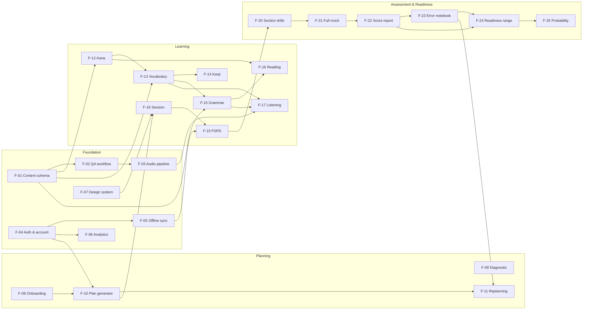

# FEATURE — N4 Pilot

**Feature inventory, dependency map, dan MVP scope.**

| Item | Keterangan |
|---|---|
| Versi | 1.0 |
| Tanggal | 26 Oktober 2026 |
| Pemilik | Product |
| Status | Draft untuk prioritization & build planning |
| Dokumen sumber | `PRD.md`, `DESIGN.md` |
| Level | JLPT N4, absolute beginner → lulus |
| Platform | PWA mobile-first; wrapper iOS/Android setelah validasi |

---

## 0. Cara Membaca Dokumen Ini

### 0.1 Definisi MVP

Di dokumen ini, **MVP = Beta**, bukan “aplikasi lengkap yang menjamin lulus”.

- **MVP/Beta** adalah rilis untuk memvalidasi loop belajar, kualitas konten, dan sinyal kesiapan dengan 50–100 pengguna.
- **V1 Public** adalah rilis pertama yang boleh dijual sebagai **“siap N4”** karena cakupan konten penuh, 3 mock, dan readiness terkalibrasi.
- **Beta bukan klaim lulus penuh.** Cakupan beta ±80% blueprint; pengguna harus melihat label “beta, cakupan belum penuh”.
- **V1 adalah launch blocker**, bukan “nice to have”.

### 0.2 Status fitur

| Status | Arti | Konsekuensi |
|---|---|---|
| **MVP** | Harus ada dan lengkap di beta. | Tidak bisa beta tanpa ini. |
| **MVP\*** | Thin slice di beta; versi penuh di V1. | Boleh disederhanakan, tetapi harus berfungsi dan diukur. |
| **V1** | Wajib sebelum public launch / sebelum menjual “siap N4”. | Boleh tidak ada di beta; tidak boleh tidak ada di V1. |
| **Later** | Setelah V1; tidak masuk critical path. | Jangan buang engineering time di sini sebelum V1 stabil. |

### 0.3 Prioritas dependensi

- **(hard)** — fitur tidak bisa berfungsi tanpa dependency.
- **(soft)** — bisa ship dengan fallback/stub, tetapi kualitas turun.
- **(data)** — butuh data dari fitur lain; boleh distub saat development.
- **—** — tidak ada dependency keras.

### 0.4 Aturan scope

1. **Content dan audio adalah critical path.** Fitur UI tidak boleh menunggu konten selesai; konten harus mulai minggu 1.
2. **Tidak ada AI di MVP.** AI adalah V1; jangan biarkan AI menjadi dependency loop inti.
3. **Tidak ada payment di beta.** Beta gratis; subscription V1.
4. **Readiness tidak boleh menipu.** Range dan gate lebih penting daripada probabilitas.
5. **Kalau waktu beta mepet, potong fitur V1/Later, bukan listening, mock, gate, atau error taxonomy.**

---

## 1. Feature Map

### 1.1 Peta fitur tingkat tinggi

Grafik ini hanya menampilkan fitur inti MVP; fitur V1/Later sengaja tidak dimasukkan agar dependency loop tetap terbaca.



### 1.2 Ringkasan jumlah fitur

| Status | Jumlah | Arti |
|---|---:|---|
| **MVP** | 16 | Lengkap di beta. |
| **MVP\*** | 9 | Thin slice di beta; penuh di V1. |
| **V1** | 8 | Launch blocker; tidak harus di beta. |
| **Later** | 3 | Setelah V1. |
| **Total** | **36** | Seluruh inventory yang direncanakan. |

**25 fitur MVP** terdiri dari 16 fitur penuh + 9 thin slice.

---

## 2. Feature List & Dependencies

### 2.1 Foundation

| ID | Fitur | Status | Depends on | PRD | DoD ringkas |
|---|---|---|---|---|---|
| **F-01** | Content schema & CMS | MVP | — | E15 | 100% item schema-valid; versioning; rollback <5 menit; coverage map. |
| **F-02** | Content QA workflow | MVP | F-01 (hard) | E15 | Tidak ada item publish tanpa 2 reviewer; error queue; audit trail. |
| **F-03** | Audio pipeline & playback | MVP | F-01, F-02 | E15 | Audio native untuk item inti; CDN; offline cache; audio start <500 ms. |
| **F-04** | Auth & account | MVP | — | E16 | Guest-first; magic link/Google/Apple; save/resume; export/delete. |
| **F-05** | Offline sync | MVP\* | F-04 (hard) | E16 | Append-only logs; no duplicate/lost review; beta current-week pack; V1 full pack. |
| **F-06** | Analytics & event schema | MVP | F-04 (soft) | E16 | Funnel, learning, readiness events; no PII; dashboard beta. |
| **F-07** | Design system & accessibility baseline | MVP | — | E16 | Token/komponen inti; WCAG 2.2 AA baseline; 0 critical axe issue. |

**Catatan foundation:**

- F-01–F-03 adalah **internal tools**, tetapi wajib untuk kualitas konten. Tanpa ini, 1.500 item akan menjadi utang teknis.
- F-05 sengaja `MVP*`: review offline harus jalan di beta; download seluruh konten baru V1.
- F-07 baseline, bukan audit penuh. Audit penuh adalah V1 launch gate.

---

### 2.2 Onboarding & Planning

| ID | Fitur | Status | Depends on | PRD | DoD ringkas |
|---|---|---|---|---|---|
| **F-08** | Onboarding & reality check | MVP | F-10 (soft) | E1 | <10 menit ke sesi pertama; 3 opsi reality check; label 2027 “perkiraan”. |
| **F-09** | Diagnostic & placement | MVP\* | F-01, F-10 | E2 | <15 menit; confidence label; beta light diagnostic; V1 adaptive. |
| **F-10** | Goal & plan generator | MVP | F-04, F-08 (data) | E3 | Generate plan <2 detik; phase, weekly focus, mock dates; bisa diedit. |
| **F-11** | Adaptive replanning & recovery | MVP | F-10, F-19, F-23 (soft) | E3 | Missed 3 hari → no pile-up; new cap -50%; explain changes. |

**Catatan planning:**

- F-08 dan F-10 punya **circular dependency** yang sengaja dipecah dengan kontrak API: plan engine (F-10) dibangun lebih dulu dengan goal dummy; onboarding (F-08) memanggilnya untuk preview.
- F-09 bukan gate untuk absolute beginner. Jika pengguna memilih “dari nol”, diagnostic dilewati dan plan mulai Phase 0.
- F-11 adalah fitur retensi yang tidak boleh ditunda ke V1: pengguna yang bolos adalah majority case, bukan edge case.

---

### 2.3 Learning

| ID | Fitur | Status | Depends on | PRD | DoD ringkas |
|---|---|---|---|---|---|
| **F-12** | Kana & sound foundation | MVP | F-01, F-03 | E5 | 95% akurasi kana; ≤3 detik/karakter; romaji off setelah gate. |
| **F-13** | Vocabulary | MVP\* | F-12, F-01, F-03 | E6 | Beta 1.200 kata; V1 1.500; 100% contoh + audio + terjemahan. |
| **F-14** | Kanji | MVP\* | F-13 (hard), F-01, F-03 | E6 | Beta 240 kanji; V1 300; selalu ada kata contoh; writing opsional. |
| **F-15** | Grammar | MVP\* | F-13 (soft), F-01 | E7 | Beta 100 point; V1 130; contrast pair; sentence ordering. |
| **F-16** | Reading | MVP\* | F-12, F-13, F-15, F-01 | E8 | Beta 40 passage; V1 80; short/mid/info retrieval; target 98% coverage. |
| **F-17** | Listening | MVP\* | F-03, F-13, F-15 | E9 | Beta 100 item; V1 200; 4 tipe N4; audio once di exam mode. |
| **F-18** | Daily session player | MVP | F-07, F-10, F-12–F17 (data), F-19 | E4 | Sesi 45 ±5 menit; resume <1 detik; offline; satu CTA. |
| **F-19** | FSRS review queue | MVP | F-01, F-05 (soft), F-13–F17 (data) | E10 | FSRS; exam-aware; leech handling; no review pile-up. |

**Catatan learning:**

- F-12 adalah gate awal. Jangan buka vocabulary/reading ke pengguna yang belum lulus kana gate, kecuali mode “coba dulu” dengan furigana/audio.
- F-14 bergantung pada F-13 karena kanji diajarkan **dalam kata**, bukan reading terisolasi.
- F-16/F-17 adalah alasan produk tidak boleh hanya menjadi SRS: keduanya harus menjadi bagian loop harian, bukan fitur sampingan.
- F-18/F-19 boleh dibangun dengan 50–100 item seed sebelum F-13–F-17 lengkap; dependency konten bertipe `(data)`, bukan blocker engineering.
- Beta counts adalah **thin slice**, bukan klaim cakupan penuh. Label beta harus terlihat.

---

### 2.4 Assessment & Readiness

| ID | Fitur | Status | Depends on | PRD | DoD ringkas |
|---|---|---|---|---|---|
| **F-20** | Section drills | MVP | F-16, F-17, F-01 | E11 | Timed drill 25/55/35 menit; mengikuti blueprint N4. |
| **F-21** | Full mock exam | MVP\* | F-20, F-03 | E11 | Beta 2 form; V1 3 form; strict timer; audio sekali; auto-submit. |
| **F-22** | Score report | MVP | F-21 | E11/E12 | Estimasi + range + gates; 3 wins/3 leaks; bukan skor resmi. |
| **F-23** | Error notebook & fix-it | MVP | F-22, F-19 | E13 | Taxonomy; fix-it 10 menit; resolved setelah 2 benar di konteks berbeda. |
| **F-24** | Readiness range & gates | MVP | F-19, F-22, F-23 (soft) | E12 | Range, gate warning, evidence; no single number; no false safe. |
| **F-25** | Pass probability & calibration | MVP\* | F-24, F-22 | E12 | Beta low-confidence; no probability sebelum bukti; V1 calibrated. |

**Catatan assessment:**

- F-22 tidak boleh menampilkan “LULUS”. Gunakan “estimasi di atas ambang” dan tampilkan gate.
- F-24 adalah **produk**, bukan dashboard kosmetik. Jika gate di bawah, status tidak boleh “Aman”.
- F-25 di beta hanya boleh muncul dengan label confidence rendah dan minimal 1 full mock + coverage 60%. Kalibrasi penuh dan status “Aman” baru V1.
- F-23 harus menangkap error dari review, drill, reading, listening, dan mock — bukan hanya mock.

---

### 2.5 Growth, Trust & Monetization

| ID | Fitur | Status | Depends on | PRD | DoD ringkas |
|---|---|---|---|---|---|
| **F-26** | What-if simulator | V1 | F-25, F-10 | E12 | <500 ms; simulasi jam/tanggal; range, bukan janji. |
| **F-27** | Exam logistics | V1 | F-08 | E18 | Countdown, checklist, link resmi; label “resmi/perkiraan”. |
| **F-28** | Notifications & weekly review | V1 | F-04, F-10, F-06 | E14 | Max 2/hari; weekly report; quiet hours; no shaming. |
| **F-29** | Streak, grace & rest day | V1 | F-10, F-28 | E14 | 2 grace day/bulan; rest day dihitung; tanpa hukuman. |
| **F-30** | AI explain | V1 | F-01, F-22, F-23 | E17 | Retrieval-first; sitasi item; fallback canonical; report. |
| **F-32** | Subscription & paywall | V1 | F-04, F-08, F-24 | Monetization | Paywall setelah value; QRIS/e-wallet; cancel 2 tap. |
| **F-33** | B2B cohort dashboard | V1 | F-04, F-06, F-21, F-24 | B2B | Pilot LPK/universitas; cohort view; export; bukan LMS penuh. |
| **F-34** | Full N4 content coverage | V1 | F-01, F-02, F-03 | Content | 1.500 kata/300 kanji/130 grammar/80 reading/200 listening/3 mock. |

**Catatan growth:**

- F-26 sebenarnya tercantum di PRD E12, tetapi sengaja dijadwalkan V1 karena membutuhkan model readiness yang stabil. Ini keputusan sequencing, bukan penurunan scope.
- F-30 bukan chatbot di tab utama. AI muncul sebagai “Kenapa?” di feedback dan error notebook.
- F-32 jangan memakai dark pattern. Free tier harus tetap berguna; paywall muncul setelah pengguna melihat gap.
- F-33 pilot dulu; jangan membangun LMS penuh sebelum ada 2–3 LOI.

---

### 2.6 Later

| ID | Fitur | Status | Depends on | PRD | DoD ringkas |
|---|---|---|---|---|---|
| **F-31** | AI conversation & shadowing | Later | F-03, F-17, F-30 | E17/V2 | Tidak dinilai sebagai skor utama; ASR opsional; privacy. |
| **F-35** | N5 & N3 tracks | Later | F-01, F-10, F-34 | V2 | Kurikulum terpisah; jangan campur dengan N4. |
| **F-36** | Speaking & writing | Later | F-31 | V2 | Produk terpisah; N4 tidak menguji speaking/writing. |

**Catatan later:**

- Jangan biarkan F-31/F-35/F-36 masuk backlog beta. Ketiganya adalah produk baru, bukan fitur kecil.
- N5 bukan track terpisah di MVP; N5 adalah fase fondasi di dalam jalur N4.

---

## 3. Dependency Chains & Critical Path

### 3.1 Lima rantai utama

**Chain 1 — Content → Learning**

```text
F-01 schema → F-02 QA → F-03 audio → F-13/14/15/16/17 → F-18 session → F-19 SRS
```

Ini rantai terpanjang. Konten dan audio harus mulai minggu 1. Engineering bisa membangun UI dengan 50–100 item seed, tetapi beta tidak bisa ship tanpa konten yang direview.

**Chain 2 — Plan → Session → Review**

```text
F-08 onboarding → F-10 plan → F-18 session → F-19 FSRS → F-20 drills
```

Plan engine bisa dibangun dengan goal dummy sebelum onboarding selesai. Kontrak API harus jelas agar F-08 dan F-10 tidak saling menunggu.

**Chain 3 — Mock → Report → Error → Readiness**

```text
F-20 drills → F-21 mock → F-22 report → F-23 error notebook → F-24 readiness → F-25 probability
```

Ini rantai yang membedakan N4 Pilot dari aplikasi belajar biasa. Jangan memotong F-22/F-23/F-24 untuk mengejar tanggal.

**Chain 4 — Offline path (bukan core build order)**

```text
F-04 auth → F-05 sync → F-19 FSRS → F-24 readiness
```

Offline review adalah fitur kepercayaan. Jika sync menghilangkan review, readiness tidak bisa dipercaya. Append-only logs + idempotency wajib. F-19 tetap bisa dibangun online-first sebelum F-05 selesai; dependency-nya `(soft)`.

**Chain 5 — Error → Replan → Session**

```text
F-23 error → F-11 replan → F-10 plan → F-18 session
```

Ini loop yang membuat aplikasi terasa seperti coach, bukan content library. Recovery mode adalah fitur yang sama pentingnya dengan mock.

### 3.2 Critical path

| Urutan | Chain | Mengapa kritis | Risiko |
|---:|---|---|---|
| 1 | F-01 → F-02 → F-03 → F-13–F17 | Konten + audio adalah workload terbesar. | Beta content slip. |
| 2 | F-18 → F-19 → F-20 → F-21 → F-22 → F-23 → F-24 | Loop inti harus terbukti. | Mock/timer/sync bug. |
| 3 | F-08 → F-10 → F-11 | Plan adalah janji produk. | Reality check menakutkan pengguna. |
| 4 | F-05 → F-19 (offline path) | Offline review memengaruhi retensi. | Duplikasi/kehilangan log. |
| 5 | F-25 → F-26 | Forecast butuh data beta. | Overpromise. |
| 6 | F-30 → F-31 | AI adalah enhancement, bukan core. | Biaya/hallucination. |

### 3.3 Parallelization

Setelah F-01/F-02/F-03/F-07 ada, tim bisa paralel:

- **Content team:** F-13–F-17, lalu F-34.
- **Platform engineer:** F-04, F-05, F-06, F-19.
- **Product engineer:** F-08, F-10, F-18, F-20–F-25.
- **Design:** F-07, F-08, F-18, F-22, F-24.
- **QA:** F-02, F-21, F-22, F-24, F-05.
- **Growth:** F-27–F-29, F-32 (V1, setelah core stabil).

### 3.4 Titik rawan dependency

| Titik rawan | Solusi |
|---|---|
| F-08 onboarding ↔ F-10 plan (siklus nyata) | Bangun F-10 engine dulu dengan goal dummy; F-08 memanggil API preview. |
| F-22 score report → F-24 readiness (satu arah) | Score report menghitung section estimate/gate sendiri; F-24 mengonsumsi attempt/mock. Tidak ada siklus. |
| F-23 error → F-11 replan (satu arah) | Replan bisa mulai dari data hari yang terlewat; error events memperkaya, bukan menjadi blocker. |
| F-30 AI → F-01 content (satu arah) | AI hanya membaca canonical content; jangan pernah menulis ke content. |

---

## 4. MVP Scope

### 4.1 Fitur yang masuk MVP (25)

**MVP penuh (16):**

- F-01 Content schema & CMS
- F-02 Content QA workflow
- F-03 Audio pipeline & playback
- F-04 Auth & account
- F-06 Analytics & event schema
- F-07 Design system & accessibility baseline
- F-08 Onboarding & reality check
- F-10 Goal & plan generator
- F-11 Adaptive replanning & recovery
- F-12 Kana & sound foundation
- F-18 Daily session player
- F-19 FSRS review queue
- F-20 Section drills
- F-22 Score report
- F-23 Error notebook & fix-it
- F-24 Readiness range & gates

**MVP thin slice (9):**

- F-05 Offline sync — review offline + current-week pack.
- F-09 Diagnostic — light placement; adaptive nanti.
- F-13 Vocabulary — 1.200 kata.
- F-14 Kanji — 240 kanji.
- F-15 Grammar — 100 point.
- F-16 Reading — 40 passage.
- F-17 Listening — 100 item.
- F-21 Full mock — 2 form.
- F-25 Pass probability — low-confidence only.

### 4.2 Fitur yang tidak masuk MVP (11)

**V1 (8):**

- F-26 What-if simulator
- F-27 Exam logistics
- F-28 Notifications & weekly review
- F-29 Streak, grace & rest day
- F-30 AI explain
- F-32 Subscription & paywall
- F-33 B2B cohort dashboard
- F-34 Full N4 content coverage

**Later (3):**

- F-31 AI conversation & shadowing
- F-35 N5 & N3 tracks
- F-36 Speaking & writing

### 4.3 MVP cut line

**Jangan dipotong dari MVP:**

- Reality check dan plan realistis (F-08/F-10).
- Daily session dan FSRS (F-18/F-19).
- Kana, vocabulary, kanji, grammar inti (F-12–F-15).
- Listening (F-17) dan minimal 1 reading type (F-16).
- 2 full mock (F-21), score report (F-22), error notebook (F-23).
- Readiness range + gate (F-24).
- Offline review (F-05 thin).
- Accessibility baseline (F-07).

**Boleh dipotong/ditunda jika beta mepet:**

- Probability (F-25) — boleh flag-off di beta awal; range + gate tetap wajib; probability low-confidence menyala setelah 1 mock + coverage 60%.
- Diagnostic (F-09) — absolute beginner tidak membutuhkannya.
- Full offline pack — current week cukup.
- 80 reading/200 listening/3 mock — beta 40/100/2.
- AI, notifications, streak, what-if, exam logistics, payments, B2B.

**Jangan pernah dipotong:**

- Section gate warning.
- Listening quota.
- Error taxonomy.
- Reality check.
- Label “estimasi, bukan skor resmi”.
- Content reviewer.

### 4.4 MVP exit criteria

| Kategori | Kriteria |
|---|---|
| **Feature** | Semua fitur MVP lulus acceptance; F-25 boleh flag-off di beta awal; 0 critical bug. |
| **Content** | Beta counts terpenuhi; 100% item inti punya reviewer + audio; content error <2% di beta, target <1% di V1. |
| **Learning** | 7-day retention ≥85%; listening +10 poin dalam 8 minggu. |
| **Habit** | 50–100 beta learners; D7 ≥30%; plan adherence ≥50%. |
| **Readiness** | Calibration error ≤12 poin; false-safe rate <5%; no probability without evidence. |
| **Technical** | Crash-free ≥99,5%; offline sync tanpa kehilangan review; LCP <2,5 detik. |
| **Trust** | Content error <2%; “forecast membantu” ≥4/5. |
| **Business** | ≥5 pengguna bersedia membayar (beta gratis; validasi willingness to pay). |

---

## 5. Build Sequence

Urutan di bawah adalah **sequencing setelah validasi 2 minggu**, bukan komitmen tanggal. Content/audio dapat menggeser tanggal; jangan mengorbankan kualitas untuk mengejar minggu.

| Fase | Minggu build | Fitur utama | Exit |
|---|---:|---|---|
| **1. Foundation + vertical slice** | 1–6 | F-01, F-02, F-04, F-06, F-07; F-08, F-10, F-12, F-18, F-19; F-03 + F-13 seed | Schema stabil; design token; 20–30 beta learners bisa menyelesaikan sesi pertama. |
| **2a. Beta core** | 7–12 | F-13–F-17 beta counts, F-20 | 80% content; reading/listening aktif; drills. |
| **2b. Assessment** | 13–15 | F-21, F-22, F-23, F-24, F-25 partial | 2 mock; score report; error notebook; range/gate. |
| **2c. Beta hardening** | 16–18 | F-05, F-09, F-11, accessibility, analytics, QA | 50–100 beta learners; MVP exit metrics. |
| **3. V1** | 19–24 | F-34, F-25 full, F-26–F-30, F-32, F-33, F-27 | Public launch untuk cohort Desember 2027. |

**Catatan:**

- Total build: **24 minggu** (6 + 12 + 6), setelah validasi 2 minggu. Ini konsisten dengan PRD.
- Phase 2a/2b/2c bisa overlap: content team melanjutkan F-14–F-17 saat engineer membangun F-21–F-24.
- V1 adalah 6 minggu setelah beta; kalau content full belum siap, **jangan launch**.
- Cohort publik: **JLPT Desember 2027**. JLPT Juli 2027 hanya untuk sprint 3+ jam/hari; bukan default.

---

## 6. Dependency Risks

| Risiko | Fitur terdampak | Mitigasi |
|---|---|---|
| Konten/audio slip | F-13–F-17, F-21, F-34 | Mulai minggu 1; beta 80%; native audio untuk item inti; TTS hanya draft. |
| Kalibrasi readiness kurang data | F-25, F-26 | Beta low-confidence; no probability tanpa minimal 1 mock + coverage 60%; recalibrate V1. |
| Offline sync duplikat/hilang | F-05, F-19, F-24 | Append-only logs; idempotency key; chaos test. |
| Timer mock bug | F-21, F-22 | Auto-submit; crash recovery; timer test 55 menit. |
| AI hallucination | F-30, F-31 | Retrieval-first; citation; fallback canonical; human review. |
| Payment friction | F-32 | QRIS/e-wallet; retry; no double charge. |
| B2B scope creep | F-33 | Pilot 2–3 LPK; dashboard cohort saja; bukan LMS. |
| Tanggal 2027 berubah | F-08, F-10, F-27 | Semua label “perkiraan”; link resmi; versioning. |
| Accessibility terlambat | F-07, semua UI | Baseline sejak komponen pertama; audit V1. |
| Scope creep N5/N3 | F-35 | Non-goal sampai V1 stabil; N5 hanya fase fondasi. |

---

## 7. Traceability ke PRD

| PRD epic | Fitur |
|---|---|
| E1 Onboarding | F-08 |
| E2 Diagnostic | F-09 |
| E3 Plan & replanning | F-10, F-11 |
| E4 Daily session | F-18 |
| E5 Kana | F-12 |
| E6 Vocabulary & kanji | F-13, F-14 |
| E7 Grammar | F-15 |
| E8 Reading | F-16 |
| E9 Listening | F-17 |
| E10 SRS | F-19 |
| E11 Drills & mock | F-20, F-21, F-22 |
| E12 Readiness | F-24, F-25, F-26 |
| E13 Error notebook | F-23 |
| E14 Notifications & habit | F-28, F-29 |
| E15 Content CMS | F-01, F-02, F-03 |
| E16 Account/offline/accessibility | F-04, F-05, F-07 |
| E17 AI | F-30, F-31 |
| E18 Exam logistics | F-27 |
| Monetization | F-32 |
| B2B | F-33 |
| Content expansion | F-34, F-35, F-36 |

---

## 8. Open Decisions

1. **Beta gratis atau paid pilot?** Rekomendasi: gratis untuk 50–100 pengguna; validasi willingness to pay lewat pre-sale, bukan paywall di beta.
2. **2 atau 3 mock di beta?** Rekomendasi: 2 form A/B; 3 form V1.
3. **Diagnostic sedalam apa?** Rekomendasi: 10 menit, fokus kana/vocab/grammar/listening; adaptive penuh V1.
4. **Offline pack beta sebesar apa?** Rekomendasi: current week + audio; full pack V1.
5. **AI di beta?** Rekomendasi: tidak. AI V1; jangan menambah dependency sebelum core stabil.
6. **B2B pilot kapan?** Rekomendasi: V1, setelah ada cohort data dan 2–3 LOI.
7. **Apakah “Aman” butuh 2 mock?** Ya; 1 mock hanya low-confidence, bukan “Aman”.
8. **Apakah full content 1.500 kata cukup?** Ini estimasi produk; validasi dengan coverage map dan item analysis, bukan klaim resmi.

---

## 9. Sumber

- `PRD.md` — problem, riset, requirements, metrik, roadmap.
- `DESIGN.md` — UX, screen specs, learning engine, arsitektur.
- JLPT. *Composition of Test Sections and Items.* https://www.jlpt.jp/e/guideline/testsections.html
- JLPT. *Scoring Sections, Pass or Fail, Score Report.* https://www.jlpt.jp/e/guideline/results.html
- JLPT Indonesia. *Pendaftaran Ujian JLPT 2026 (Desember).* https://jlptonline.or.id/news/pendaftaran-ujian-jlpt-2026-desember

**Catatan versi:** FEATURE 1.0 menetapkan 36 fitur, 25 di antaranya MVP (16 penuh + 9 thin slice), 8 V1, dan 3 Later. Definisi MVP adalah beta validasi, bukan jaminan lulus; V1 adalah rilis pertama yang boleh dijual sebagai “siap N4”.
