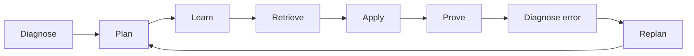

# PRD — N4 Pilot

**Dari nol ke JLPT N4 — dengan rencana yang jujur dan latihan yang terbukti.**

| Item | Keterangan |
|---|---|
| Versi | 2.0 — riset ulang & siap eksekusi |
| Tanggal | 25 Oktober 2026 |
| Pemilik | Product |
| Status | Draft untuk validasi, lalu build |
| Audiens | Founder, engineering, design, content, growth |
| Level | JLPT N4, absolute beginner → lulus |
| Platform | PWA mobile-first; wrapper iOS/Android setelah validasi |
| Bahasa UI | Bahasa Indonesia (utama), English (opsional) |
| Bahasa konten | Jepang + penjelasan Indonesia |
| Nama kerja | **N4 Pilot** |

---

## 0. Ringkasan Eksekutif

### Tesis produk

Pelajar Indonesia tidak kekurangan materi belajar Jepang. Mereka kekurangan **keputusan**:

> Apa yang harus saya kerjakan hari ini, berapa lama, dan seberapa dekat saya benar-benar dengan lulus?

JLPT N4 adalah masalah **deadline** dengan **section gate** yang tidak bisa ditawar. Dari nol, estimasi belajar yang dilaporkan adalah **575–1.000 jam** bagi pelajar tanpa latar belakang kanji [36]. Sebagian besar aplikasi menjual konten, aktivitas, atau streak. N4 Pilot menjual **jalur yang jelas menuju kelulusan** — dan keberanian untuk mengatakan kebenaran ketika jalur itu tidak realistis.

**N4 Pilot adalah exam-readiness operating system:**

1. **Diagnose** — titik awal, target tanggal, dan waktu yang benar-benar tersedia.
2. **Plan** — rencana harian yang dihitung dari tanggal ujian, bukan dari jumlah konten.
3. **Learn** — kana, kosakata, kanji, grammar, dan listening dalam konteks.
4. **Retrieve** — spaced repetition dengan FSRS, disesuaikan dengan tanggal ujian.
5. **Apply** — membaca dan mendengar dalam tugas yang menyerupai JLPT.
6. **Prove** — section drill dan full mock yang timed, unseen, dan diskor.
7. **Replan** — setiap jawaban, mock, dan hari yang terlewat mengubah rencana besok.

### Keputusan produk yang paling penting

> **Kami tidak menjual “N4 dalam 3 bulan”. Kami menjual 575–1.000 jam yang tidak terbuang.**

Klaim “cepat” yang bertanggung jawab adalah:

- **1 jam/hari, 6 hari/minggu** → 22–38 bulan. Jangan janjikan 6–12 bulan.
- **1,5 jam/hari, 6 hari/minggu** → 15–26 bulan.
- **2 jam/hari, 6 hari/minggu** → 11–19 bulan.
- **2,25 jam/hari, 6 hari/minggu** → sekitar 12 bulan untuk target perencanaan 700 jam.
- **3,25 jam/hari, 6 hari/minggu** → sekitar 8–9 bulan untuk target perencanaan 700 jam.
- **4 jam/hari, 6 hari/minggu** → 6–10 bulan, dengan risiko burnout yang nyata.

Angka di atas memakai rentang 575–1.000 jam dan 6 hari belajar per minggu. Bukan janji; ini **planning envelope** yang harus ditampilkan jujur di onboarding.

### Untuk siapa

Pelajar dewasa Indonesia, **absolute beginner**, yang menargetkan N4 dalam **12–18 bulan** dengan **2–2,5 jam/hari**, atau **9–12 bulan** dengan **3+ jam/hari**, memakai Android mid-range, dan butuh struktur, umpan balik, serta bukti kemajuan. Sekunder: mahasiswa yang mengejar ujian Juli dengan intensitas lebih tinggi, dan calon pekerja Jepang yang membutuhkan N4 untuk jalur **Specified Skilled Worker (SSW)** [15].

Bukan untuk: orang yang ingin lulus N4 dalam 3 bulan dengan 10 menit/hari; pembelajar N1/N2; atau orang yang hanya ingin nonton anime tanpa struktur.

### Diferensiasi

| Diferensiasi | Mengapa penting |
|---|---|
| **Exam-date plan** | Tanggal ujian fixed; aplikasi umum open-ended. |
| **Section-gate guardrails** | Listening < 19/60 = gagal, walau total 150. |
| **Exam-aware SRS** | Review dijadwalkan agar item high-yield segar pada hari ujian. |
| **Listening-first** | Listening adalah failure mode tersembunyi; dapat kuota harian. |
| **Honest forecast** | Peluang lulus ditampilkan sebagai rentang + confidence, bukan angka palsu. |
| **Error → remediation** | Kesalahan diklasifikasi penyebabnya dan diubah menjadi latihan berikutnya. |
| **Recovery mode** | Setelah bolos, tidak ada tumpukan review yang menghukum. |
| **Indonesian-first** | Penjelasan natural, contoh lokal, dan konteks SSW/LPK. |
| **AI assist, bukan AI authority** | AI menjelaskan dari konten kanonik; tidak mengarang kurikulum. |

### Scope MVP

**Beta (bukan klaim lulus penuh):**

- Loop harian, plan, FSRS, readiness awal, 2 full mock (form A/B).
- Cakupan ±80% blueprint: 1.200 kata, 240 kanji, 100 grammar, 40 reading, 100 listening.
- Android-first PWA, Bahasa Indonesia, offline review.

**V1 publik (wajib sebelum menjual “siap N4”):**

- Cakupan penuh: ±1.500 kata kumulatif, ±300 kanji kumulatif, ±130 grammar kumulatif.
- 80+ reading, 200+ listening, 3 full mock, error notebook, readiness terkalibrasi.
- Listening lab 4 tipe N4, reading 3 tipe N4, section drills, exam logistics.

### Ukuran keberhasilan

- **North Star:** median **Verified Readiness Gain (VRG)** ≥ **+6 poin skala per 4 minggu** untuk pelajar aktif, diukur dari timed unseen practice — bukan jumlah pelajaran.
- **Outcome:** ≥ **70%** beta completer lulus; **forecast calibration error ≤ 10 poin**; **false-safe rate < 5%**.
- **Habit:** D30 ≥ 20%; plan adherence ≥ 60%; burnout report < 10%.
- **Trust:** content error < 1%; “forecast membantu” ≥ 4/5.
- **Business:** trial→paid ≥ 8%; CAC payback < 6 bulan.

### Rekomendasi

Setujui **validasi 2 minggu + build 24 minggu** dengan tim inti 3 engineer, 1 designer, 1 PM, 1 content lead, 2 Japanese reviewer, 2 Indonesian editor, 1 audio producer, dan 1 QA. **Content adalah critical path**; authoring dimulai minggu 1, bukan setelah app jadi.

Target cohort publik: **JLPT Desember 2027**. Untuk JLPT Juli 2027, hanya jalur sprint 3+ jam/hari yang masuk akal — dan itu harus ditampilkan sebagai risiko, bukan default.

---

## 1. Konteks & Masalah

### 1.1 Masalah yang sebenarnya

Pelajar dari nol tidak kekurangan sumber. Mereka kekurangan:

1. **Urutan** — mulai dari mana, berapa banyak, kapan pindah.
2. **Umpan balik** — salah karena tidak tahu kata, tidak paham grammar, atau tidak menangkap audio?
3. **Kalibrasi** — latihan yang terasa mudah tidak selalu memprediksi ujian.
4. **Batas waktu** — tanggal ujian fixed, tetapi belajar biasanya open-ended.
5. **Kejujuran** — aplikasi cenderung menunjukkan “progress” yang menyenangkan, bukan kesiapan yang sebenarnya.
6. **Pemulihan** — setelah melewatkan 3 hari, tumpukan review membuat orang berhenti.

Akibatnya:

- Berminggu-minggu di hiragana/katakana, lalu panik di listening.
- Menghafal kanji tanpa kosakata, lalu tidak bisa membaca kalimat.
- Menonton video dan merasa paham, tetapi gagal saat audio diputar sekali.
- Mengerjakan mock, melihat skor, lalu tidak tahu apa yang harus diperbaiki.
- Kehilangan momentum setelah bolos karena aplikasi menghukum dengan 500 review.

### 1.2 Mengapa sekarang

- **Permintaan besar.** Indonesia memiliki **732.914 pelajar bahasa Jepang** pada survei Japan Foundation 2024 — peringkat kedua dunia — dan **3.103 institusi**, peringkat pertama [12][13][14].
- **Jalur kerja nyata.** Banyak sektor SSW mensyaratkan **JLPT N4 atau JFT-Basic A2.2**, misalnya bidang makanan dan minuman [15][16]. N4 bukan sekadar hobi; ini tiket.
- **Pass rate rendah.** N4 global Desember 2025: **34,6%**; Juli 2025: **36,8%** [6][7]. Self-selection membuat angka ini bukan ukuran “sulit”, tetapi cukup untuk menunjukkan bahwa persiapan asal-asalan tidak cukup.
- **Biaya konten turun, tetapi kepercayaan langka.** TTS/ASR, open data (JMdict, KANJIDIC2, KanjiVG), dan LLM memudahkan produksi draft. Moat bukan generate konten; moat adalah **kalibrasi item, kualitas review, data belajar, dan kepercayaan pada forecast**.
- **Scheduling makin matang.** FSRS open-source memungkinkan penjadwalan yang lebih personal daripada SM-2 [25].
- **Belum ada pemain Indonesia yang fokus pada readiness.** Kompetitor kuat di konten (Bunpro, MaruMori, WaniKani, Renshuu), tetapi belum ada yang menjadikan **tanggal ujian + section gate + forecast** sebagai inti produk.

### 1.3 Mengapa app, bukan sekadar kumpulan PDF/deck?

Konten bisa dibeli. Yang tidak bisa dibeli dari deck gratis:

- Urutan yang menyesuaikan diri dengan tanggal ujian dan waktu harian.
- Deteksi section mana yang akan membuat gagal.
- Latihan format ujian yang timed dan unseen.
- Penjelasan kesalahan yang menghubungkan item, grammar, dan strategi.
- Rencana pemulihan setelah hidup terjadi.

Jika N4 Pilot hanya menjadi “Anki dengan konten N4”, ia akan kalah oleh deck gratis. Jika hanya menjadi “question bank”, ia akan kalah oleh buku latihan. Produk harus memiliki **decision layer**.

### 1.4 Mengapa N4, bukan N5 atau N3?

- **N5 terlalu rendah untuk banyak tujuan praktis.** N5 adalah fondasi, bukan tujuan kerja.
- **N3 terlalu jauh untuk “dari nol” dalam 12–18 bulan yang realistis.**
- **N4 adalah level yang finite, terverifikasi, dan berguna** — termasuk untuk SSW dan beberapa jalur pendidikan/kerja.
- **N4 tetap bukan fluency.** JLPT tidak menguji speaking/writing [3][5]. Produk harus mengatakan ini sejak onboarding: “Kami membantumu lulus N4; bukan menjanjikan percakapan lancar.”

---

## 2. Riset: Apa yang Benar-Benar Diuji N4

### 2.1 Metode riset

Riset ini menggabungkan:

1. **Dokumen resmi JLPT** — struktur tes, scoring, item types, CEFR, FAQ, statistik 2025 [1–7][11].
2. **Sumber resmi Indonesia** — jadwal, biaya, lokasi, aturan pendaftaran [8–10].
3. **Meta-analisis & studi kognitif** — retrieval, spacing, interleaving, cognitive load, feedback, extensive reading.
4. **Studi spesifik Jepang** — kanji, shadowing, pitch accent, listening.
5. **Teardown kompetitor** — Anki, WaniKani, Bunpro, Renshuu, MaruMori, Migaku, Duolingo, tutor manusia.
6. **Data pasar** — Japan Foundation 2024, statistik JLPT 2025, persyaratan SSW.

**Batas riset:** Ini riset sekunder. Belum ada wawancara pengguna primer. Banyak bukti belajar berasal dari pembelajaran bahasa Inggris; transfer ke Jepang perlu validasi. Data jam belajar bersifat self-reported. JLPT tidak mempublikasikan silabus resmi, sehingga cakupan N4 adalah pemetaan komunitas + analisis item internal — bukan daftar resmi. Kami akan mengkalibrasi ulang dengan data mock dan hasil ujian pengguna.

### 2.2 Struktur tes N4

| Aspek | Fakta resmi | Implikasi produk |
|---|---|---|
| **Definisi level** | Mampu memahami bahasa Jepang dasar: bacaan topik sehari-hari dengan kosakata/kanji dasar; percakapan sehari-hari yang diucapkan perlahan [3]. | Latihan berbasis konteks sehari-hari, bukan kalimat terisolasi. |
| **Test sections** | Language Knowledge (Vocabulary) **25 menit**; Language Knowledge (Grammar)・Reading **55 menit**; Listening **35 menit** [1]. | Tiga sesi latihan terpisah; timer dan stamina harus dilatih. |
| **Scoring sections** | N4 punya **2 scoring sections**: Language Knowledge (Vocabulary/Grammar)・Reading **0–120**; Listening **0–60**. Total **0–180** [2]. | Readiness harus section-aware, bukan satu angka total. |
| **Pass mark** | Total **≥90**; Knowledge+Reading **≥38/120**; Listening **≥19/60**. Jika satu section di bawah gate, gagal walau total tinggi [2]. | Objective function: menaikkan section terlemah, bukan total. |
| **Format** | Pilihan ganda, kebanyakan 4 opsi; beberapa listening 3 opsi. Tidak ada speaking/writing [3][5]. | Latihan harus format-aware; jangan buang waktu menguji handwriting. |
| **Scoring** | Scaled score berbasis IRT, bukan raw score [5]. | Mock tidak bisa dikonversi mentah-mentah; tampilkan estimasi + rentang. |
| **Listening** | Audio diputar sekali di ujian; tidak ada replay. | Practice boleh replay; exam mode harus sekali dengar. |
| **CEFR** | Lulus N4 dengan total ≥90 dipetakan sebagai **A2** (receptive) sejak Desember 2025 [4]. | Bisa dipakai untuk komunikasi eksternal; tetap jelaskan keterbatasannya. |

> **Catatan blueprint:** JLPT menyatakan alokasi waktu tiap section dapat berubah [1]. Karena itu, blueprint tes harus **versioned** dan app harus menampilkan “berdasarkan format 2026” sampai ada pembaruan resmi.

### 2.3 Item types N4 — tepat, bukan asumsi

| Section | Item types resmi N4 [1] | Yang harus dilatih |
|---|---|---|
| **Vocabulary** | Kanji reading; Orthography; Contextually-defined expressions; Paraphrases; Usage. | Membaca kanji dalam kata, ejaan katakana, makna dalam konteks, sinonim, penggunaan. |
| **Grammar** | Sentential grammar 1 (selecting grammar form); Sentential grammar 2 (sentence composition); Text grammar. | Memilih bentuk, menyusun kalimat, kohesi antar-kalimat. |
| **Reading** | Comprehension (short passages); Comprehension (mid-size passages); Information retrieval. | Membaca cepat, memahami inti, scanning tabel/notis. **Tidak ada long passage di N4.** |
| **Listening** | Task-based comprehension; Comprehension of key points; Verbal expressions; Quick response. | Menyelesaikan tugas, menangkap poin, memahami ungkapan, merespons cepat. **Tidak ada general outline di N4.** |

> **Koreksi penting:** Banyak panduan komunitas menambahkan “long reading” dan “general outline listening” ke N4. Keduanya tidak ada di blueprint resmi N4 [1]. Membangun latihan untuk tipe yang tidak diuji adalah pemborosan waktu.

### 2.4 Jadwal & logistik Indonesia

| Item | Status per 25 Oktober 2026 |
|---|---|
| JLPT 2026 | Minggu, **5 Juli** dan **6 Desember 2026** [1]. |
| Pendaftaran Juli 2026 | 7–15 April 2026; sudah tutup [8]. |
| Pendaftaran Desember 2026 | 31 Agustus–7 September 2026; **sudah tutup** [9]. |
| Biaya N4 | **Rp250.000** (berlaku mulai Juli 2026), di luar biaya admin [10]. |
| Kota | 16 kota pada Desember 2026, termasuk Jakarta, Bandung, Surabaya, Medan, Yogyakarta, Denpasar, Makassar [9]. |
| JLPT 2027 | **Belum diumumkan.** Aplikasi tidak boleh menampilkan tanggal 2027 sebagai fakta. |
| Implikasi | Ujian terdekat yang mungkin bagi pengguna baru adalah **Juli 2027** (perkiraan), dan itu hanya realistis dengan 3+ jam/hari. Default yang jujur: **Desember 2027**. |

### 2.5 Berapa lama dari nol?

Data self-reported untuk pelajar tanpa latar belakang kanji: **N4 575–1.000 jam** [36]. Tabel ini menghitung **6 hari belajar per minggu** dan 52 minggu/tahun.

| Jam/hari | Jam/minggu | Bulan ke 575 jam | Bulan ke 1.000 jam |
|---:|---:|---:|---:|
| 0,5 | 3 | 44 | 77 |
| 1,0 | 6 | 22 | 38 |
| 1,5 | 9 | 15 | 26 |
| 2,0 | 12 | 11 | 19 |
| 2,5 | 15 | 9 | 15 |
| 3,0 | 18 | 7 | 13 |
| 3,25 | 19,5 | 7 | 12 |
| 4,0 | 24 | 5,5 | 10 |

**Target perencanaan produk: 700 jam**, bukan 575 jam, untuk memberi buffer review, mock, sakit, dan kehidupan. Ini bukan angka ilmiah; ini **budget planning** yang harus dikoreksi dengan data aktual.

**Rekomendasi jujur:**

- **1 jam/hari** → 22–38 bulan. Bisa, tetapi jangan pasang target 12 bulan.
- **1,5 jam/hari** → 15–26 bulan.
- **2–2,25 jam/hari** → 11–19 bulan; **12 bulan** adalah target yang masuk akal dengan 2,25 jam × 6 hari.
- **3–3,25 jam/hari** → 7–13 bulan; **8–9 bulan** mungkin, dengan risiko tinggi.
- **4+ jam/hari** → 5,5–10 bulan, dengan risiko burnout dan retensi.

**Konsekuensi produk:** Jika jam yang tersedia < 80% dari batas bawah (575 jam) untuk tanggal yang dipilih, onboarding **wajib** menampilkan reality check dan tiga opsi: tambah jam, geser tanggal, atau lanjut dengan risiko. Ini fitur kepercayaan, bukan penghalang konversi.

### 2.6 Mitos vs fakta

| Mitos | Fakta |
|---|---|
| “N4 bisa dalam 3 bulan dari nol dengan 15 menit/hari.” | Tidak kredibel terhadap 575–1.000 jam. Mungkin hanya untuk orang dengan fondasi besar. |
| “Hafal 1.500 kata = lulus.” | Kosakata penting, tetapi listening dan reading timed juga gate. |
| “Kanji harus dihafal semua reading-nya.” | N4 menguji reading dalam kata/konteks; on/kun yang tidak relevan adalah biaya waktu. |
| “Nonton anime = immersion.” | Bisa membantu listening, tetapi tanpa comprehensible input dan feedback, sering menjadi passive exposure. |
| “Mock bagus = pasti lulus.” | Mock hanya prediktor; JLPT memakai scaled score dan form berbeda. Butuh kalibrasi. |
| “Speaking tidak penting.” | Untuk lulus N4, benar — tidak diuji. Untuk hidup/kerja, tetap penting; kami tidak mencampurnya di MVP. |
| “Streak panjang = siap.” | Streak mengukur kebiasaan, bukan kesiapan ujian. |

---

## 3. Riset: Metode Belajar Paling Efektif & Cepat

### 3.1 Sintesis bukti

| Metode | Bukti | Grade | Cara diterapkan |
|---|---|---|---|
| **Retrieval practice** | Practice testing menghasilkan retensi jangka panjang lebih baik daripada rereading [17][19]. | A | Setiap sesi dimulai dengan recall; kuis di akhir unit; feedback. |
| **Spaced practice** | Meta-analisis 839 asesmen: interval optimal meningkat seiring retention interval [18]. | A | FSRS; review lintas hari; exam-aware scheduling. |
| **Worked examples + faded guidance** | Efektif untuk novice; mengurangi cognitive load [28][29]. | A/B | Contoh penuh → prompting dikurangi → latihan mandiri. |
| **Corrective feedback** | Meta-analisis 33 studi: efek medium, bertahan; implicit feedback lebih bertahan [22]. | B | Feedback spesifik, bukan hanya benar/salah; jelaskan cause. |
| **Extensive reading** | Meta-analisis 34 studi: efek medium (d = 0,46) pada reading proficiency [20]. | B | Graded reading dengan coverage tinggi; bukan teks bebas yang terlalu sulit. |
| **Comprehensible input** | Diperlukan, tetapi “i+1” sulit dioperasionalkan; coverage kata adalah proxy yang lebih baik [21]. | B | Target 98% known untuk reading mandiri; 95% untuk listening dengan dukungan. |
| **Interleaving** | Bermanfaat terutama untuk materi yang mirip/confusable; bukan hukum universal [33]. | B | Blocked untuk konsep baru → mixed drill untuk grammar/kanji mirip. |
| **Output + feedback** | Output memaksa form-meaning mapping; feedback memperkuat akurasi [34][22]. | B | Typing, sentence ordering, shadowing, menjelaskan alasan. |
| **Shadowing** | Studi Jepang menunjukkan manfaat listening; sampel kecil, effect size bervariasi [24]. | B/C | Listening lab: listen → dictation → shadow → compare. |
| **Kanji mnemonics** | Berguna sebagai scaffold; overreliance dapat merusak makna dan reading [23]. | C | Mnemonic untuk encoding; review tetap retrieval dalam kata/konteks. |
| **Pitch accent training** | Training multimodal meningkatkan persepsi; belum tentu penting untuk lulus N4 [26]. | B/C | Audio dari hari 1; pitch overlay opsional, bukan gate. |
| **Implementation intentions** | “If-then” plan meningkatkan follow-through [30]. | B | Onboarding membuat waktu & trigger spesifik; pengingat kontekstual. |
| **Self-determination** | Autonomy, competence, relatedness mendukung motivasi [31]. | B | Pilihan track, bukti kompetensi, cohort opsional; tanpa leaderboard publik. |
| **Sleep & consolidation** | Tidur berperan dalam konsolidasi memori [32]. | B | Review lintas hari; “sleep on it”; taper; jangan cram. |

**Prinsip sintesis:**

> Encoding multimodal → retrieval yang di-spacing → interleaving setelah paham → aplikasi dalam konteks baru → feedback → revisi → simulasi ujian.

Tidak ada satu metode ajaib. Metode tercepat adalah **kombinasi yang mengurangi waktu terbuang**, bukan menambah jam.

### 3.2 The N4 Accelerated Loop

Ini adalah metode inti produk, diturunkan dari bukti di atas:

1. **Decode** — kana dan bunyi sampai otomatis. Tanpa ini, semua input lambat.
2. **Encode** — kata frekuensi tinggi dan kanji **dalam kata**, bukan reading terisolasi.
3. **Comprehend** — input graded dengan 95–98% kata yang sudah dikenal; i+1 yang terkontrol.
4. **Retrieve** — recall aktif dengan FSRS; gagal adalah sinyal, bukan aib.
5. **Apply** — tugas format JLPT yang timed: sentence ordering, information retrieval, quick response.
6. **Diagnose** — kesalahan diklasifikasi: knowledge, discrimination, parsing, decoding, memory, strategy.
7. **Simulate** — full mock berkala; latihan stamina dan keputusan di bawah waktu.
8. **Recover & taper** — tidur, konsolidasi, dan berhenti menambah materi baru di akhir.

### 3.3 Apa yang mempercepat vs memperlambat

**Mempercepat:**

- Frekuensi tinggi: 80% hasil dari 20% kata/grammar yang paling sering muncul.
- Konteks: kata dalam kalimat, grammar dalam percakapan, kanji dalam kata.
- Feedback yang menjelaskan **kenapa**.
- Latihan format ujian sejak dini, dalam dosis kecil.
- Listening setiap hari, bahkan 10 menit.
- Fokus satu blok waktu, tanpa multitasking.
- Tidur cukup dan review besoknya.
- Mengurangi keputusan: satu CTA, satu rencana.

**Memperlambat:**

- Romaji sebagai crutch.
- Menghafal semua on/kun kanji.
- Menonton video pasif tanpa retrieval.
- Menulis kanji sebagai gate padahal N4 tidak menguji writing.
- Menunda listening sampai “kosakata cukup”.
- Mock terlalu sering tanpa analisis.
- Pindah-pindah aplikasi.
- Cramming semalam sebelum ujian.
- Streak yang membuat bersalah saat istirahat.

### 3.4 Implikasi khusus bahasa Jepang

| Area | Yang penting | Mekanik produk |
|---|---|---|
| **Kana** | Hiragana & katakana harus otomatis; romaji menjadi crutch. | Drill 2–3 minggu; audio + stroke; gate 95%; romaji default off setelah gate. |
| **Kanji** | Kanji bukan kata. Belajar bentuk, radikal, arti, dan reading **dalam kosakata**. | Kanji card + word card + context sentence; stroke order opsional; common readings only. |
| **Kosakata** | Frekuensi dan konteks lebih penting daripada daftar alfabetis. | Urutkan berdasarkan frekuensi + exam likelihood; contoh kalimat + audio. |
| **Grammar** | Form-meaning-use; nuansa dan kontras antar pola. | Pattern card, contrast pair, common error, sentence ordering. |
| **Listening** | Bukan sekadar tahu kata; butuh decoding cepat, sound changes, memory. | 4 tipe N4; audio once di exam mode; dictation; shadowing. |
| **Reading** | Kecepatan, scanning, information retrieval, stamina. | 3 tipe N4; timed passages; furigana toggle; lookup; exam mode. |
| **Pitch accent** | Membantu persepsi, tetapi bukan gate N4. | Audio native; pitch overlay opsional; minimal pairs. |
| **Test craft** | Tanpa negative marking; listening sekali; section gate. | Micro-lessons strategi; mock strict; “jawab semua, jangan kosong”. |

### 3.5 Localization untuk pelajar Indonesia

Ini bukan sekadar terjemahan. Pelajar Indonesia menghadapi:

- **Tidak ada konjugasi verba** dalam bahasa Indonesia → te-form, conditional, passive, causative perlu eksplisit.
- **Tidak ada partikel** → は/が, に/で, を/が adalah area error utama.
- **Tidak ada honorifik gramatikal** → 敬語 recognition perlu dilatih, terutama listening.
- **Aksara baru** → kana dan kanji menambah beban awal; perlu segmentasi dan mnemonik yang tidak infantilizing.
- **Katakana loanwords** → banyak kata terasa familiar tetapi maknanya bergeser.
- **Vokal & panjang pendek** → おばさん/おばあさん, ゆき/ゆうき; latihan minimal pairs.
- **Konteks kerja** → contoh dari dunia kerja, LPK, dan kehidupan sehari-hari, bukan hanya sekolah.

**Keputusan:** Penjelasan grammar dan error feedback ditulis oleh **Indonesian editor**, bukan diterjemahkan mesin dari bahasa Inggris. Ini adalah moat kualitas yang sulit ditiru.

### 3.6 Yang tidak akan kami lakukan

- Menjanjikan lulus atau “pass guarantee”.
- Menjual learning styles (visual/auditory) sebagai personalization.
- Menjadikan handwriting kanji sebagai gate kelulusan.
- Menampilkan skor JLPT seolah-olah resmi.
- Membuat leaderboard publik yang mempermalukan.
- Menghasilkan item kanonik dengan AI tanpa review manusia.
- Menyalin soal/audio JLPT resmi.
- Menambah konten baru 3 minggu sebelum ujian.

---

## 4. Riset: Pengguna, Pasar, Kompetitor

### 4.1 Konteks pasar

| Fakta | Angka | Implikasi |
|---|---:|---|
| Pelajar bahasa Jepang di Indonesia (2024) | **732.914** | Pasar besar; Indonesia peringkat #2 dunia [12][13][14]. |
| Institusi bahasa Jepang | **3.103** | Indonesia peringkat #1; kanal B2B/LPK nyata [13]. |
| Guru bahasa Jepang | **7.614** | Perlu alat untuk cohort/placement; bukan hanya B2C. |
| Pemohon N4 2025 | **435.575** | N4 adalah level dengan volume besar [6][7]. |
| Peserta N4 2025 | **372.864** | 35,6% certified; banyak yang tidak siap [6][7]. |
| Biaya ujian N4 | **Rp250.000** | Biaya masuk rendah; keputusan membeli app harus jelas nilainya [10]. |
| Kebutuhan SSW | N4 atau JFT-Basic A2.2 | Use case konkret: kerja, bukan hanya hobi [15][16]. |

**Catatan:** 732.914 adalah pelajar di institusi pendidikan (SMP/SMA/kampus/nonformal), bukan jumlah calon pengguna app. Ini adalah **market ceiling**, bukan TAM yang bisa diklaim. App menyasar subset dewasa mandiri dan peserta SSW.

### 4.2 Persona utama — “Rani”

- **Profil:** 27 tahun, account executive di Jakarta, absolute beginner, bekerja penuh waktu.
- **Target:** lulus N4 untuk kualifikasi kerja/relokasi dalam 12–15 bulan.
- **Waktu:** 2–2,25 jam/hari, 6 hari/minggu; sering melewatkan 2–3 hari saat sibuk.
- **Perangkat:** Android mid-range, koneksi tidak selalu stabil, sering belajar di commuter.
- **Pain:** bingung urutan; takut listening; merasa sibuk tapi tidak tahu kemajuan; kehilangan momentum setelah bolos.
- **Kebutuhan:** rencana yang menyesuaikan diri, sesi singkat yang jelas, bukti kemajuan, dan jawaban jujur “apakah aku on track?”
- **Quote:** “Aku bukan malas. Aku cuma nggak tahu harus mulai dari mana dan apakah usahaku cukup.”

### 4.3 Persona sekunder — “Bagas”

- **Profil:** 22 tahun, mahasiswa tingkat akhir, target N4 6–8 bulan lagi.
- **Waktu:** 3–4 jam/hari, lebih intensif.
- **Pain:** butuh struktur ketat, mock exam, dan analisis kesalahan; mudah overconfidence setelah latihan mudah.
- **Kebutuhan:** sprint plan, full mock, error taxonomy, forecast.

### 4.4 Persona tersier — “Maya”

- **Profil:** 34 tahun, calon pekerja Jepang (SSW), butuh N4 untuk syarat kerja.
- **Waktu:** 1,5 jam/hari, 5–6 hari/minggu.
- **Pain:** listening percakapan kerja terasa cepat; tidak punya banyak uang; butuh bukti lulus.
- **Kebutuhan:** listening praktis, kosakata kerja, latihan format JLPT, biaya lokal, offline.
- **Catatan:** Untuk SSW, N4 atau JFT-Basic A2.2 adalah syarat; app harus menjelaskan perbedaan dan tidak mengklaim N4 = siap kerja sepenuhnya [15][16].

### 4.5 Anti-persona

- Ingin lulus N4 dalam 3 bulan dengan 10 menit/hari — produk akan mengatakan tidak realistis.
- Hanya ingin menonton anime tanpa struktur — bukan core.
- N1/N2 — tidak dilayani di MVP.
- Mencari tutor manusia 1:1 — N4 Pilot adalah pelengkap, bukan marketplace.
- Ingin kursus speaking tanpa ujian — di luar scope.

### 4.6 Jobs to be Done

**Functional**

- Saat aku punya 45 menit, bantu aku tahu persis apa yang harus dikerjakan supaya tidak buang waktu.
- Saat aku salah, jelaskan penyebabnya dan beri latihan yang memperbaikinya.
- Saat ujian makin dekat, bantu aku fokus pada hal yang paling menaikkan peluang lulus.
- Saat aku bolos, rapikan rencanaku tanpa membuatku tenggelam.

**Emotional**

- Bantu aku merasa benar-benar maju, bukan hanya sibuk.
- Jangan buat aku merasa bersalah saat istirahat atau melewatkan hari.
- Buat aku percaya bahwa rencana ini realistis.

**Social**

- Bantu aku membuktikan bahwa aku bisa lulus N4.
- Beri aku cara menunjukkan progres ke diri sendiri (dan orang lain, opsional).

**Exam-specific**

- Beri tahu aku apakah aku on track, seksi mana yang berisiko, dan apa yang harus dilakukan 2 minggu sebelum ujian.
- Jangan biarkan aku “aman” di total padahal listening di bawah gate.

### 4.7 Teardown kompetitor

| Produk | Kekuatan | Gap untuk kebutuhan N4 |
|---|---|---|
| **Anki** | SRS powerful, gratis, fleksibel. | Setup berat; deck tidak exam-aware; tidak ada plan, mock, atau readiness. |
| **WaniKani** | Kanji & vocab SRS dengan mnemonic kuat; 2.000 kanji/6.000 kata. | Tidak ada grammar, reading, listening, mock; tidak exam-date-driven. |
| **Bunpro** | Grammar SRS, 900+ grammar, 120+ reading passages, vocab, harga $5/bulan. | Fokus grammar; bukan sistem kesiapan ujian menyeluruh. |
| **Renshuu** | All-in-one, banyak mode, kamus, komunitas, gamifikasi. | Luas, tetapi tidak memiliki exam-date plan + forecast sebagai inti. |
| **MaruMori** | All-in-one N5–N1, grammar, kanji, vocab, reading, SRS, gamifikasi; $8,99/bulan. | Kuat di konten; positioning bukan “apakah saya siap pada tanggal X?” |
| **Migaku** | Immersion & mining. | Untuk learner mandiri; tidak menyusun silabus N4 atau menjamin coverage. |
| **Duolingo** | Engagement tinggi, gratis, mudah dimulai. | Tidak cukup untuk N4; tidak ada mock/readiness; progres tidak calibrated. |
| **Tutor/kelas** | Feedback manusia, akuntabilitas. | Mahal, frekuensi rendah; tidak menggantikan latihan harian. |
| **Question-bank apps** | Banyak soal format JLPT, murah. | Tidak mengajari urutan, konsep, atau pemulihan; sering hanya drilling. |

**Gap pasar:** belum ada produk yang menggabungkan **exam-date plan + section-gate guardrails + exam-aware SRS + JLPT-format practice + calibrated readiness + listening-first + Bahasa Indonesia** dalam satu loop sederhana.

**Sumber fitur/harga publik:** Bunpro [37], MaruMori [38], WaniKani [39], Renshuu [40]. Ini bukan audit produk; fitur dapat berubah.

### 4.8 Positioning

> Untuk pelajar dewasa Indonesia yang harus lulus JLPT N4 dari nol, **N4 Pilot** adalah exam-readiness coach yang mengubah tanggal ujian menjadi rencana harian, membuktikan kemajuan lewat latihan timed, dan mengatakan dengan jujur ketika kamu berisiko — bukan content library yang mengoptimalkan streak.

**Messaging pillars:**

- **Jujur:** “Kami akan bilang kalau targetmu belum realistis.”
- **Terukur:** “Kamu akan tahu peluang lulusmu, bukan cuma streak.”
- **Terarah:** “Setiap hari, satu hal terbaik untuk dilakukan.”
- **Terbukti:** “Retrieval, spacing, dan latihan format JLPT.”

### 4.9 Asumsi yang harus divalidasi

| Asumsi | Cara validasi | Kriteria |
|---|---|---|
| Pengguna mau commit 2–2,5 jam/hari | 10–15 wawancara + survey | ≥60% mengatakan realistis |
| Reality check tidak menurunkan konversi secara fatal | A/B onboarding | Penurunan conversion ≤10%, trust naik |
| Listening adalah pain utama | Wawancara + analytics beta | ≥50% menyebut listening |
| Pengguna mau bayar Rp49k–79k/bulan | Landing page + pre-sale | ≥8% trial→paid |
| Mobile-first PWA cukup | Beta usage | ≥70% sesi dari mobile |
| LPK/universitas butuh dashboard cohort | 5 wawancara B2B | ≥2 pilot letters of intent |
| AI explanation menambah learning gain | A/B | retensi naik, cost terkendali |

---

## 5. Visi, Misi, Prinsip

### Visi

Setiap orang punya jalur yang jelas dari nol ke N4 — tanpa menebak-nebak, tanpa membuang waktu.

### Misi

Mengubah 575–1.000 jam belajar menjadi **rencana harian yang bisa dieksekusi, diukur, dan dipercaya**.

### Prinsip produk

1. **Honest over flattering.** Tampilkan kesiapan sebenarnya, termasuk risiko gagal.
2. **One next best action.** Setiap layar menjawab “apa yang harus aku lakukan sekarang?”
3. **Practice like the test, learn beyond it.** Latihan meniru format JLPT; pembelajaran tetap mendalam.
4. **Listening is first-class.** Bukan fitur tambahan; kuota harian dan gate sendiri.
5. **Retrieval by default.** Recall sebelum review pasif.
6. **Context before isolation.** Kata dalam kalimat; kanji dalam kata; grammar dalam percakapan.
7. **Calm urgency.** Deadline terasa, tetapi tidak bikin panik.
8. **Respect rest.** Istirahat adalah bagian dari rencana, bukan kegagalan.
9. **No dead ends.** Setiap kesalahan menghasilkan langkah perbaikan.
10. **AI assists, never authorizes.** AI menjelaskan dari konten kanonik; bukan sumber kebenaran.
11. **Accessible by default.** Low-end device, koneksi lambat, dan screen reader tetap bisa belajar.
12. **Evidence, not theater.** Jangan bangun fitur karena terlihat keren; bangun karena menaikkan peluang lulus.

---

## 6. Goals, Non-Goals, Metrik

### 6.1 Product goals

1. **Pass N4** dengan skor target dan semua section gate.
2. **Know readiness** — pengguna bisa melihat peluang lulus dan apa yang harus diperbaiki.
3. **Sustain habit** — 4+ sesi/minggu selama 80% minggu belajar.
4. **Trust** — forecast akurat dan konten Jepang berkualitas.
5. **Business** — model subscription yang sehat di Indonesia.

### 6.2 Non-goals (MVP)

- N5, N3, N2, N1 sebagai track terpisah. N5 content disertakan sebagai fondasi.
- Speaking fluency / conversation marketplace.
- Social network / leaderboard publik.
- Anime/immersion library.
- Sertifikasi resmi atau jaminan lulus.
- AI-generated curriculum tanpa review manusia.
- Handwriting kanji sebagai gate.
- Desktop-first experience.

### 6.3 North Star Metric

**Verified Readiness Gain (VRG)**

> Median kenaikan **estimated scaled score** per pelajar aktif per **4 minggu**, yang diukur hanya dari **timed unseen section test atau full mock**, bukan dari self-report atau jumlah pelajaran selesai.

Target awal: **+6 poin skala per 4 minggu** untuk pelajar dengan ≥3 sesi/minggu. Metrik ini mencegah “vanity progress”. Angka target akan dikalibrasi ulang setelah beta; jangan mengklaim presisi sebelum ada data.

### 6.4 Metric tree

| Kategori | Metrik | Target MVP |
|---|---|---|
| **Outcome** | Mock terakhir: prediksi lulus ≥80% | ≥80% peserta mock |
| **Outcome** | Actual pass rate (survey 2 bulan setelah ujian) | ≥70% beta completer |
| **Calibration** | Mean absolute error forecast vs mock | ≤10 poin |
| **Calibration** | False-safe rate (diprediksi aman, ternyata gagal) | <5% |
| **Activation** | Onboarding complete + first session + plan created | ≥75% |
| **Activation** | First timed mini-section dalam 7 hari | ≥60% |
| **Engagement** | D7 / D30 retention | ≥35% / ≥20% |
| **Adherence** | Weekly plan completion | ≥60% |
| **Learning** | Review retention (7-day) | ≥85% |
| **Listening** | Listening accuracy improvement 8 minggu | +10 poin |
| **Quality** | Content error reports | <1% item |
| **Trust** | “Forecast membantu” survey | ≥4/5 |
| **Business** | Trial → paid | ≥8% |
| **Guardrail** | Reported burnout | <10% |
| **Guardrail** | Notification opt-out | <15% |
| **Guardrail** | Refund | <5% |

### 6.5 OKRs (2 kuartal pertama)

**O1: Pelajar beta mencapai kesiapan N4 yang terukur.**

- KR1: 60% beta learners menyelesaikan minimal 2 mock.
- KR2: Median VRG ≥ +6 poin/4 minggu.
- KR3: Forecast calibration error ≤ 10 poin.
- KR4: 70% beta learners melaporkan “tahu apa yang harus diperbaiki”.

**O2: Habit terbentuk tanpa burnout.**

- KR1: D30 ≥ 20%.
- KR2: Plan adherence ≥ 60%.
- KR3: Burnout report < 10%.
- KR4: 50% learners menggunakan “Quick 10” minimal sekali/minggu.

**O3: Model bisnis tervalidasi.**

- KR1: 8% trial→paid.
- KR2: CAC payback < 6 bulan.
- KR3: NPS ≥ 30.

---

## 7. Solusi

### 7.1 Loop inti

Setiap putaran menghasilkan data yang membuat rencana berikutnya lebih baik. Ini adalah **learning flywheel**, bukan konten statis.

### 7.2 Tiga track

| Track | Durasi | Beban | Target jam | Cocok untuk |
|---|---|---:|---:|---|
| **Sustainable** | 52 minggu | 2,25 jam/hari × 6 hari | 702 jam | Pekerja dengan komitmen stabil; default dari nol. |
| **Sprint** | 36 minggu | 3,25 jam/hari × 6 hari | 702 jam | Target Juli 2027; disiplin tinggi; risiko burnout. |
| **Intensive** | 24 minggu | 4,5 jam/hari × 6 hari | 648 jam | Hanya untuk yang sudah punya fondasi atau bisa belajar penuh waktu. |

Catatan: track bukan janji. Jika pengguna memilih track yang tidak cocok dengan jamnya, app menampilkan reality check dan konsekuensinya.

### 7.3 Fase kurikulum & gate

| Fase | Estimasi jam | Outcome | Gate |
|---|---:|---|---|
| **0. Foundations** | 25–35 | Kana otomatis, bunyi, 150 kata pertama, 30 kanji, 10 grammar dasar. | 95% akurasi kana; bisa membaca kata baru dengan audio. |
| **1. N5 Bridge** | 80–110 | 500 kata, 100 kanji, 40 grammar, reading/listening sederhana. | Mini-section ≥60%; retensi 7 hari ≥80%. |
| **2. N4 Core A** | 120–160 | 900 kata, 180 kanji, 70 grammar, kalimat kompleks. | Section drill stabil; error taxonomy terkendali. |
| **3. N4 Core B** | 150–200 | 1.500 kata, 300 kanji, 130 grammar, semua item type N4. | Coverage ≥90%; listening ≥ gate. |
| **4. Integration** | 100–130 | Timed reading, listening lab, 2 mock (form A/B). | Mock mendekati target; tidak ada section di bawah gate. |
| **5. Exam Simulation** | 60–80 | 3 mock total (1 form baru + 2 review), pacing, error repair. | Stabil di 2 mock berturut-turut. |
| **6. Taper** | 15–20 | Review high-yield, tidur, logistik. | Tidak ada materi baru; kesiapan stabil. |

Total: **550–735 jam** untuk cakupan produk; target perencanaan 700 jam. Angka ini adalah estimasi produk, bukan angka resmi JLPT.

**Gate bukan sekadar waktu.** Pengguna tidak naik fase hanya karena kalender; mereka naik setelah memenuhi kriteria mastery. Jika belum, planner memperpanjang fase atau mengurangi konten baru.

### 7.4 Anatomi sesi harian

| Mode | Durasi | Komposisi |
|---|---:|---|
| **Quick 10** | 10 menit | 4 review + 3 input + 3 listening. |
| **Core 45** | 45 menit | 12 review + 15 input + 10 apply + 8 listening. |
| **Deep 90** | 90 menit | 25 review + 25 input + 25 apply + 15 listening. |
| **Sprint 150** | 150 menit | 45 review + 40 input + 40 apply + 25 listening. |

Prinsip:

- Mulai dengan recall, bukan review pasif.
- Satu konsep per layar.
- Listening minimal 20–25% dari sesi.
- Akhiri dengan retrieval dan satu insight.
- Tidak ada iklan di tengah sesi.

### 7.5 Readiness — ringkas

Readiness dihitung per domain → per scoring section → overall.

**Inputs:** mastery per item, predicted retention at exam date, coverage, timed performance, mock, consistency (sebagai confidence, bukan skor), dan jumlah bukti.

**Outputs:** estimasi skor per section + rentang, status gate, peluang lulus + rentang, top 3 faktor, dan “apa yang paling menaikkan peluang minggu ini”.

**Prinsip:**

- Tampilkan **range**, bukan satu angka.
- Jangan tampilkan skor JLPT seolah-olah resmi.
- Jika data kurang, tampilkan “belum cukup data”.
- Jika satu section di bawah gate, overall tidak boleh terlihat “aman”.
- Kalibrasi dengan mock; revisi model setiap 2 minggu.

Detail model, formula, dan aturan tampilan ada di `DESIGN.md`.

### 7.6 Aha moments

Dalam **10 menit pertama**, pengguna harus:

1. Melihat rencana yang realistis untuk tanggal ujiannya.
2. Menyelesaikan satu sesi kecil yang terasa relevan.
3. Melihat satu bukti kemajuan (“kamu sudah bisa membaca 12 kata N4”).
4. Mengerti bahwa produk ini tidak akan menipu mereka.

Dalam **7 hari**, pengguna harus:

1. Menyelesaikan satu timed mini-section.
2. Melihat readiness pertama dengan rentang dan label “bukti masih sedikit”.
3. Menerima satu rekomendasi perbaikan yang spesifik.

### 7.7 Mapping research → fitur

| Fitur | Research basis |
|---|---|
| Review queue | Retrieval practice + spacing [17][18][19] |
| Mixed drills | Interleaving untuk materi confusable [33] |
| Grammar contrast | Elaborative interrogation / discrimination |
| Worked examples | Cognitive load / worked example effect [28][29] |
| Graded reading | Extensive reading / comprehensible input [20][21] |
| Shadowing & dictation | Listening decoding / output [24][34] |
| Error taxonomy | Deliberate practice / feedback [22] |
| Section gates | Test validity / consequential validity [2] |
| Weekly review | Goal setting & feedback [30][31] |
| Reality check | Calibration & trust |
| Taper & sleep | Memory consolidation [32] |

---

## 8. Functional Requirements

Prioritas: **P0 = MVP/beta**, **P1 = v1 publik**, **P2 = v1.1+**.

### E1. Onboarding, goal setting & reality check (P0)

**User story:** Sebagai absolute beginner, saya ingin menetapkan target ujian dan waktu belajar agar mendapat rencana yang realistis.

**Requirements**

- Pilih starting point: “Dari nol” / “Sudah kenal kana” / “Pernah belajar sedikit” / “Punya skor mock”.
- Pilih tanggal ujian: Juli 2027 (perkiraan), Desember 2027 (perkiraan), atau custom. Tampilkan disclaimer bahwa tanggal 2027 belum diumumkan.
- Pilih target skor: lulus (90) / aman (110) / kuat (130).
- Pilih jam per hari dan hari belajar; tampilkan total jam/minggu.
- Reality check otomatis terhadap 575–1.000 jam.
- Pilih preferensi: furigana, romaji, audio autoplay, pengingat.
- Plan preview: fase, minggu pertama, tanggal mock.
- First session dalam <5 menit.

**Acceptance criteria**

- Given tanggal + jam menghasilkan <80% batas bawah, when user lanjut, then tampil 3 opsi (tambah jam, geser tanggal, lanjut dengan risiko) dan estimasi dampaknya.
- Plan preview berubah <1 detik saat slider jam digeser.
- Tidak ada istilah “gagal” di onboarding; gunakan “risiko” dan “opsi”.
- Jika user skip diagnostic, plan dimulai dari Phase 0.
- User bisa mengedit goal tanpa mengulang onboarding.

### E2. Diagnostic & placement (P0)

**User story:** Sebagai pengguna, saya ingin tahu titik awal saya agar tidak belajar hal yang sudah dikuasai atau melewatkan dasar.

**Requirements**

- Absolute beginner: skip diagnostic, mulai dari kana check 3 menit.
- Non-beginner: adaptive diagnostic 10–15 menit, mencakup kana, vocab, kanji, grammar, listening, reading.
- Estimasi ability per domain + confidence.
- Rekomendasi starting phase.
- Diagnostic bisa diulang kapan saja.

**Acceptance criteria**

- Diagnostic <15 menit; bisa di-pause.
- Hasil menampilkan “confidence: low/medium/high” dan alasan.
- Tidak menampilkan skor JLPT palsu; gunakan “estimasi awal”.
- Jika listening belum dites, readiness listening diberi label “belum cukup data”.

### E3. Study plan & adaptive replanning (P0)

**User story:** Sebagai pelajar sibuk, saya ingin rencana yang menyesuaikan diri saat saya bolos atau maju cepat.

**Requirements**

- Generate phase plan: Foundations → N5 Bridge → N4 Core A → N4 Core B → Integration → Exam Simulation → Taper.
- Weekly focus dan daily budget.
- Mock schedule (setiap 2 minggu di fase integrasi).
- Replan triggers:
  - Missed 1 day: redistribute dalam minggu.
  - Missed 3+ days: Recovery Mode (new item -50%, fokus review & high-yield).
  - Accuracy <70%: kurangi new item, tambah prerequisite.
  - Listening <60%: tambah listening + shadowing.
  - Exam <21 hari: stop new content; consolidation + timed practice.
  - Ahead of plan: bonus immersion, bukan menambah new item tanpa batas.
- “Minimum viable day” 10 menit.

**Acceptance criteria**

- Replan selesai <2 detik; user melihat apa yang berubah dan why.
- Tidak ada penumpukan review setelah bolos; review di-reschedule dengan load balancing.
- Exam week: tidak ada item baru; hanya review high-yield + mock ringan + istirahat.
- User bisa “pin” hari libur; plan menghormatinya.
- Perubahan plan dijelaskan dalam bahasa manusia, bukan log algoritma.

### E4. Daily session player (P0)

**User story:** Sebagai pengguna, saya ingin sesi yang jelas, singkat, dan bisa diselesaikan di mana saja.

**Requirements**

- Blok: Review (20–30%), Learn (25–35%), Apply (20–30%), Listening (15–25%), Prove (5–10%).
- Satu konsep per layar; progres terlihat.
- Audio preload; offline mode.
- Pause/exit dengan save state.
- Mode 10/45/90/150 menit.
- End summary: item learned, accuracy, next review, one insight.
- Tidak ada iklan di tengah sesi.

**Acceptance criteria**

- Sesi 45 menit bisa diselesaikan dalam 45 ± 5 menit.
- Exit di tengah sesi menyimpan posisi; resume <1 detik.
- Sesi offline berfungsi untuk review + konten yang sudah diunduh.
- Jika audio gagal, fallback ke transkrip + tombol retry, bukan block.

### E5. Kana & sound foundation (P0)

**User story:** Sebagai pemula, saya ingin membaca hiragana/katakana otomatis agar bisa belajar kosakata.

**Requirements**

- Hiragana & katakana: bentuk, stroke order, audio, mnemonic.
- Dakuten, handakuten, yōon, long vowels, small tsu.
- Confusion pairs (shi/tsu, so/n, ru/ro, dll.).
- Typing & recognition drills.
- Audio minimal pairs untuk panjang pendek (opsional).
- Gate: 95% accuracy + kecepatan ≤3 detik/karakter.

**Acceptance criteria**

- Setiap karakter punya audio native + stroke animation.
- Review kana terintegrasi SRS.
- Setelah gate, romaji default off; user bisa mengaktifkan di settings.
- Latihan tidak hanya multiple choice; ada typing dan listening.

### E6. Vocabulary & kanji (P0)

**User story:** Sebagai pelajar N4, saya ingin menguasai kata dan kanji dalam konteks agar bisa membaca dan mendengar.

**Requirements**

- ±1.500 kata kumulatif (N5+N4) di v1; beta 1.200 kata. Setiap kata punya reading, pitch accent opsional, POS, arti Indonesia, contoh kalimat, audio, tags.
- ±300 kanji kumulatif di v1; beta 240 kanji. Setiap kanji punya arti, radical, stroke order opsional, readings yang relevan, kata contoh, mnemonic, common mistakes.
- Card modalities: recognize meaning, recall form, read in context, listen in context.
- Leech handling: ganti modalitas, tambah mnemonic, sederhanakan, atau suspend.
- “Contrast drill” untuk kata/kanji mirip.
- Kanji writing canvas opsional (P1), bukan gate.

**Acceptance criteria**

- 100% item punya contoh kalimat + audio + terjemahan Indonesia.
- Kanji tidak diajarkan tanpa kata contoh.
- Review queue mencampur modality sesuai stage.
- Item report button di setiap layar.
- Writing feedback (jika ada) toleran terhadap variasi stroke; fokus pada bentuk, bukan seni kaligrafi.

### E7. Grammar (P0)

**User story:** Sebagai pelajar, saya ingin memahami pola grammar dan nuansanya, bukan sekadar menghafal terjemahan.

**Requirements**

- ±130 grammar point kumulatif (N5+N4) di v1; beta 100. Sekitar 80 adalah materi baru N4.
- Struktur: meaning, formation, nuance, 3 contoh, contrast pair, common error, 5 drills.
- Latihan: cloze, sentence ordering, matching, text grammar.
- Mixed review untuk pola serupa.
- Penjelasan Indonesia yang natural; hindari terjemahan literal.

**Acceptance criteria**

- Setiap point punya minimal 1 contrast dengan pola lain.
- Sentence ordering mengikuti format JLPT (sentential grammar 2).
- Feedback menjelaskan kenapa opsi salah, bukan hanya jawaban benar.
- Grammar point terkait muncul sebagai link “bandingkan”.

### E8. Reading (P0)

**User story:** Sebagai pelajar, saya ingin membaca teks N4 dengan percaya diri dan cepat.

**Requirements**

- 80+ passage di v1; 40+ di beta.
- Tipe: short, mid-size, information retrieval. **Tidak ada long passage.**
- Furigana toggle: all / hover / off.
- Tap-to-lookup dengan konteks.
- Timer & reading speed.
- Exam mode: no lookup, timed.
- Post-reading: vocab mining, grammar highlight, comprehension review.
- Adaptive selection: target 98% known vocabulary; floor 95% dengan dukungan.

**Acceptance criteria**

- Setiap passage punya audio opsional + pertanyaan berformat JLPT.
- Sistem menolak passage jika known coverage <90% untuk learner (kecuali exam mode).
- Setelah jawab, user melihat bukti dari teks (highlight kalimat kunci).
- Reading speed dan accuracy ditampilkan di progress.

### E9. Listening (P0)

**User story:** Sebagai pelajar, saya ingin berlatih mendengar Jepang yang diucapkan sekali, karena itu yang terjadi di ujian.

**Requirements**

- 4 tipe N4: task-based, key points, verbal expressions, quick response. **Tidak ada general outline.**
- Practice mode: speed 0.75–1.25, replay, transcript after answer.
- Exam mode: audio once, no replay, no transcript until end.
- Dictation: ketik apa yang didengar; diff feedback.
- Shadowing: rekam, bandingkan; ASR feedback kata yang terlewat (opsional).
- Sound changes: てしまう→ちゃう, なければ→なきゃ, という→って, devoiced vowels, long vowels, small tsu.
- Daily listening quota (minimal 15 menit; 20–25% sesi).
- Background noise mode (P1).

**Acceptance criteria**

- Audio native, jelas, tidak TTS untuk item inti.
- Transcript tidak terlihat sebelum jawab di exam mode.
- Shadowing menyimpan rekaman lokal secara default; upload opt-in.
- ASR feedback tidak menghukum aksen; fokus pada kata/kalimat yang hilang.
- Setiap item punya penjelasan distractor.

### E10. SRS & review (P0)

**User story:** Sebagai pelajar, saya ingin review yang efisien dan tidak menumpuk.

**Requirements**

- FSRS per card; parameter default; desired retention 0.90.
- Exam-aware:
  - Max interval = days until exam.
  - Final review high-weight items 5–10 hari sebelum ujian.
  - No review after exam unless user sets next goal.
- Load balancing: hindari spike due cards.
- Review queue: due + overdue + high-yield + leech.
- Rating: Again / Hard / Good / Easy; auto-grade untuk multiple choice.
- Offline review + sync.
- “Cram mode” untuk exam week (tanpa mengubah jangka panjang).

**Acceptance criteria**

- Review queue muncul <1 detik.
- Sinkronisasi offline tidak menghasilkan duplikasi review.
- Jika user mengubah tanggal ujian, interval di-reschedule.
- Item leech (4 lapses) masuk “Fix-it” session, bukan terus muncul tanpa perubahan.

### E11. Drills, mock exam & score report (P0)

**User story:** Sebagai pelajar, saya ingin merasakan ujian sebenarnya agar tidak kaget pada hari-H.

**Requirements**

- Section drills: Vocabulary 25 menit; Grammar/Reading 55 menit; Listening 35 menit.
- Full mock: 2 form di beta; 3 form di v1; strict timer; pause hanya antar-seksi.
- Answer sheet UI; tidak ada negative marking; ajarkan “jawab semua”.
- Listening audio sekali; tidak ada replay.
- Score report:
  - Estimasi scaled score + range.
  - Section gates (38/120, 19/60, total 90).
  - Item-level review.
  - Error taxonomy.
  - 3 wins, 3 leaks, next 7 days.
- Post-mortem dalam 24 jam.
- Mock bisa diulang dengan form berbeda.

**Acceptance criteria**

- Full mock dapat diselesaikan tanpa bug timer; auto-submit saat waktu habis.
- Score report membedakan “estimasi” dari “skor resmi”.
- Setiap salah masuk error notebook dengan taxonomy.
- Setelah mock, plan 7 hari berikutnya otomatis diperbarui.
- Jika satu seksi < gate, dashboard menampilkan warning dan fokus.

### E12. Readiness dashboard & forecast (P0)

**User story:** Sebagai pelajar, saya ingin tahu peluang lulus dan apa yang harus diperbaiki.

**Requirements**

- Readiness score 0–100 per domain dan section.
- Pass probability + confidence range.
- Status: Belum cukup data / Berisiko / Di jalur / Aman.
- Section breakdown: Knowledge+Reading, Listening.
- Coverage: vocab, kanji, grammar, reading, listening.
- Retention: predicted recall at exam date.
- Forecast: “Dengan jam saat ini, proyeksi siap tanggal X”.
- What-if simulator: jam/hari vs peluang lulus.
- Explainability: “Kenapa 68%?” dengan 3 faktor utama.
- Disclaimer: estimasi, bukan jaminan.

**Acceptance criteria**

- Readiness update setelah setiap sesi/mock; tidak pernah menampilkan satu angka tanpa range.
- Jika data belum cukup untuk peluang lulus, tampil “butuh 1 mock lagi” atau “estimasi awal” dengan label confidence; jangan angka palsu.
- Warning jika listening < gate atau Knowledge+Reading < gate.
- What-if tidak membutuhkan reload; <500ms.
- User bisa melihat “apa yang paling menaikkan peluang saya minggu ini?”.

### E13. Error notebook & remediation (P0)

**User story:** Sebagai pelajar, saya ingin kesalahan saya menjadi latihan, bukan hanya riwayat.

**Requirements**

- Auto-capture wrong answers dari review, drill, reading, listening, mock.
- Taxonomy: unknown word, kanji misread, grammar pattern, nuance, parsing, listening decoding, memory, time, format, distractor.
- Group by cause, not just item.
- “Fix-it” session 10 menit.
- Status: open / in progress / resolved.
- Mistake of the day di Home.
- Re-test setelah 3–7 hari.

**Acceptance criteria**

- Setiap wrong answer punya taxonomy + 1 rekomendasi.
- Fix-it session menggunakan item serupa, bukan hanya ulangan item yang sama.
- Resolved jika benar 2x dalam konteks berbeda.
- Error notebook bisa difilter by domain/date/type.

### E14. Notifications & habit (P1)

**User story:** Sebagai pelajar sibuk, saya ingin pengingat yang membantu, bukan mengganggu.

**Requirements**

- Pilih waktu & hari; quiet hours.
- Notifikasi: sesi harian, review due, weekly report, exam countdown.
- Streak dengan 2 grace days/bulan.
- Rest day dihitung sebagai bagian plan.
- Weekly review: 5 menit, 3 pertanyaan.
- “If-then” plan: “Jika jam 7 pagi, maka 20 menit review.”
- Tidak ada notifikasi shaming.

**Acceptance criteria**

- Maksimal 2 notifikasi/hari; opt-out mudah.
- Streak tidak hilang karena rest day yang direncanakan.
- Weekly report menampilkan 1 win, 1 leak, 1 next action.
- User bisa pause notifikasi 1 minggu tanpa kehilangan plan.

### E15. Content CMS & authoring (P0 internal)

**User story:** Sebagai content team, saya ingin membuat, mereview, dan mempublikasikan konten dengan aman.

**Requirements**

- Schema validasi untuk item, example, question, passage, audio.
- Preview learner-facing.
- Review workflow: draft → Japanese review → Indonesian review → audio QA → publish.
- Versioning & rollback.
- Item analytics: difficulty, discrimination, flag rate.
- Bulk import dari YAML/CSV; media pipeline.
- Role-based access.

**Acceptance criteria**

- Tidak ada item publish tanpa 2 reviewer.
- Setiap item punya `content_version`.
- Rollback <5 menit.
- Item error report masuk queue.
- CMS bisa menampilkan coverage map N4.

### E16. Account, sync, offline, accessibility (P0)

**User story:** Sebagai pengguna, saya ingin belajar di mana saja tanpa kehilangan progres.

**Requirements**

- Auth: email magic link, Google, Apple.
- Sync: review logs, sessions, plan, settings.
- Offline: content pack harian, audio, review queue.
- Low-data mode.
- Accessibility: WCAG 2.2 AA, screen reader, keyboard, reduce motion, font scaling.
- Data export & delete.
- Privacy: audio lokal by default.

**Acceptance criteria**

- Offline review tersimpan dan tersinkron saat online.
- Konflik sync tidak menghilangkan review; server recompute canonical state.
- LCP <2,5 detik pada 4G mid-range Android.
- Semua tombol ≥44px; kontras ≥4,5:1.
- Screen reader bisa membaca kanji dengan label arti/reading.

### E17. AI coach (P1)

**User story:** Sebagai pelajar, saya ingin penjelasan personal saat bingung.

**Requirements**

- “Explain why” untuk jawaban salah.
- Generate mnemonic kanji (reviewed/flagged).
- Generate contoh kalimat tambahan dengan grammar target.
- Conversation practice terbatas (bukan penilaian utama).
- Retrieval dari konten canonical; sitasi ke item.
- Guardrails: no hallucinated grammar; fallback ke penjelasan canonical.
- Rate limit & cost cap.

**Acceptance criteria**

- AI explanation hanya menggunakan item content yang disetujui.
- Setiap output punya sitasi ke minimal 1 item canonical.
- User bisa report output; flagged output masuk review queue.
- Biaya AI <$0,30/active learner/month.
- Tidak ada AI-generated item yang masuk SRS tanpa review.

### E18. Exam logistics (P1)

**User story:** Sebagai peserta, saya ingin tahu persyaratan ujian agar tidak kehilangan kesempatan.

**Requirements**

- Countdown ujian.
- Checklist: pendaftaran, foto, identitas, lokasi, transport, jam datang.
- Link resmi JLPT Indonesia dan JLPT global.
- Reminder tanggal pendaftaran (berdasarkan pengumuman resmi, bukan asumsi).
- Tidak memproses pembayaran ujian.

**Acceptance criteria**

- Semua tanggal disertai label “resmi” atau “perkiraan”.
- Tidak ada klaim jaminan kursi.
- Link keluar membuka sumber resmi.
- User bisa menyimpan catatan lokasi/transport.

---

## 9. Content Requirements

### 9.1 Volume

| Domain | Beta | V1 publik | Catatan |
|---|---:|---:|---|
| Kana | 92 dasar + kombinasi | 92 + kombinasi | Hiragana, katakana, dakuten, yōon. |
| Kosakata | 1.200 | ±1.500 kumulatif | N5+N4; frekuensi & exam likelihood. |
| Kanji | 240 | ±300 kumulatif | N5+N4; readings hanya yang relevan. |
| Grammar | 100 | ±130 kumulatif | ~80 inti N4 baru; sisanya N5. |
| Reading | 40 | 80+ | Short, mid, information retrieval. |
| Listening | 100 | 200+ | 4 tipe N4. |
| Mock | 2 | 3 full | Blueprint mengikuti tes resmi; form A/B untuk kalibrasi. |
| Test craft | 8 | 12 micro-lessons | Pacing, elimination, note-taking, answer sheet. |

**Catatan:** Jumlah ini adalah estimasi untuk perencanaan, bukan daftar resmi. JLPT tidak mempublikasikan Test Content Specifications sejak 2010 [5]. Produk harus memetakan ke item types resmi, bukan mengklaim “daftar resmi N4”.

### 9.2 Quality bar

Setiap item harus:

- **Akurat:** direview Japanese teacher; tidak ada reading/terjemahan error.
- **Natural:** contoh kalimat terdengar seperti bahasa Jepang nyata, bukan textbook kaku.
- **Level-fit:** ≥95% kosakata sudah dikenal; grammar target jelas.
- **Audio:** native atau TTS terkalibrasi; kecepatan natural; noise minimal.
- **Explanation:** menjelaskan kenapa, bukan hanya apa; contrast dengan pola serupa.
- **Translation:** Indonesia natural, bukan literal.
- **Inclusive:** nama, peran, dan konteks beragam; hindari stereotip.
- **Traceable:** `content_version`, author, reviewer, source.

### 9.3 Sumber & lisensi

- **Open data:** JMdict (CC BY-SA), KANJIDIC2 (CC BY-SA), KanjiVG (CC BY-SA), Tatoeba (CC BY).
- **Official JLPT:** gunakan practice workbook sebagai referensi format; **jangan copy** soal/audio resmi [11].
- **Community lists:** referensi silang; buat mapping sendiri; jangan copy konten.
- **Audio:** rekaman original atau TTS dengan lisensi komersial; simpan bukti lisensi.
- **AI-generated:** hanya draft; review manusia wajib untuk item yang dipublikasikan.
- **Legal review:** sebelum publisitas, audit lisensi dan hak audio.

### 9.4 Content QA workflow

1. **Blueprint** — mapping item ke N4 domain & item type.
2. **Draft** — authoring di YAML/MDX.
3. **Japanese review** — native teacher cek naturalness, reading, pitch.
4. **Indonesian review** — editor cek terjemahan & nada.
5. **Audio QA** — pronunciation, speed, loudness.
6. **Pilot** — 20–30 learners; item analysis.
7. **Publish** — versioned content pack.
8. **Monitor** — flag rate, difficulty, discrimination; revise.

### 9.5 Content metrics

- **Coverage:** % blueprint N4 yang punya item + audio + explanation.
- **Accuracy:** error reports per 1.000 item views.
- **Difficulty fit:** % item dengan p-value 0,4–0,8 pada learner target.
- **Discrimination:** item yang tidak membedakan kuat/lemah ditandai.
- **Audio quality:** flag rate.
- **Translation quality:** 5-point reviewer score.
- **Time-to-review:** median jam dari flag ke fix.

---

## 10. Readiness, Personalization, AI

### 10.1 Readiness model (high-level)

Readiness dihitung per domain, lalu per scoring section, lalu overall.

**Inputs**

- Mastery per item (accuracy, speed, modality).
- Predicted retention at exam date (FSRS).
- Coverage (weighted by exam blueprint).
- Timed section performance.
- Mock performance (estimated scaled score).
- Consistency (untuk confidence, bukan menaikkan skor).
- Jumlah bukti dan uncertainty.

**Output**

- Domain readiness 0–100.
- Knowledge+Reading readiness 0–100.
- Listening readiness 0–100.
- Pass probability + range.
- “What to fix next” (top 3 factors).
- Evidence label: “belum cukup data / awal / cukup / kuat”.

**Prinsip**

- Tampilkan **range**, bukan satu angka.
- Jangan tampilkan skor JLPT seolah-olah resmi.
- Jika data benar-benar minim (<100 attempt dan belum ada mock), tampilkan “belum cukup data”.
- Jika sudah ada bukti latihan tetapi belum ada mock, tampilkan “estimasi awal” dengan rentang lebar dan **tanpa peluang lulus**.
- Peluang lulus hanya setelah minimal 1 full mock dan coverage ≥60%; status **Aman** butuh minimal 2 mock.
- Jika satu section di bawah gate, overall tidak boleh terlihat “aman”.
- Kalibrasi dengan mock; revisi model setiap 2 minggu.

Detail formula dan simulasi ada di `DESIGN.md`.

### 10.2 Personalization

- **Plan personalization:** jam, hari, tanggal ujian, starting level, kecepatan.
- **Content personalization:** item selection berdasarkan weakness, prerequisite, exam weight, decay.
- **Session personalization:** panjang sesi, rasio review/new, domain mix.
- **Feedback personalization:** error taxonomy → remediation.
- **Tone personalization:** encouraging vs direct; user can choose.
- **Not too much:** jangan personalize segalanya; default yang baik lebih penting.
- **No learning styles:** personalisasi berdasarkan data performa, bukan preferensi “visual/auditory”.

### 10.3 AI use cases & guardrails

**Use cases**

- Explain why an answer is wrong, dengan referensi ke canonical content.
- Generate extra examples untuk grammar point (reviewed).
- Generate mnemonic untuk kanji (reviewed/flagged).
- Summarize weekly progress dalam Bahasa Indonesia natural.
- Conversation practice untuk listening/speaking (P2).

**Guardrails**

- **Retrieval-first:** AI hanya menjawab dari content snippets yang disetujui.
- **No canonical content generation without review.**
- **Cite the item:** “Lihat grammar point 〜ながら.”
- **Fallback:** jika confidence rendah, tampilkan penjelasan canonical.
- **Cost cap:** cache, small model, rate limit.
- **Privacy:** audio tidak dikirim ke third party tanpa consent.
- **Safety:** no medical/legal advice; no exam cheating.
- **Evaluation:** golden set factuality, naturalness, pedagogical alignment, Indonesian clarity.

### 10.4 Data flywheel

1. Learner answers item.
2. System estimates ability & item difficulty.
3. Scheduler chooses next item.
4. Mock calibrates readiness.
5. Content team sees difficult/ambiguous items.
6. Content improves.
7. Readiness becomes more accurate.
8. Trust increases → retention → more data.

### 10.5 Hipotesis yang diuji

| Hipotesis | Eksperimen | Metrik |
|---|---|---|
| Reality check meningkatkan trust tanpa merusak conversion | A/B onboarding | trial→paid, NPS, refund |
| Exam-aware SRS meningkatkan mock score vs FSRS standar | Cohort | mock gain, review load |
| Kuota listening harian menurunkan section failure | Cohort | listening score, pass rate |
| Recovery mode meningkatkan D30 vs pile-up | A/B | D30, adherence, burnout |
| Forecast range lebih dipercaya daripada angka tunggal | A/B | trust survey, conversion |
| AI explanation meningkatkan learning gain | A/B | review retention, cost |

---

## 11. Trust, Safety, Privacy, Accessibility

### 11.1 Trust

- **No pass guarantee.** Forex adalah estimasi, bukan janji.
- **No fake urgency.** Countdown boleh, panic-selling tidak.
- **No false safe.** Section gate harus terlihat sebelum overall.
- **No dark patterns.** Cancel subscription mudah; refund jelas.
- **No shaming.** Tidak ada notifikasi “kamu mengecewakan streak”.
- **Content provenance.** Setiap item punya versi, reviewer, dan sumber.
- **Koreksi cepat.** Error report <24 jam untuk item kritis.

### 11.2 Safety

- Tidak ada konten yang mendorong cheating atau membocorkan soal.
- AI tidak memberi nasihat medis/legal.
- Konten budaya dihormati; hindari stereotip.
- Moderasi untuk fitur komunitas (jika ada).
- Rate limit untuk AI dan API.

### 11.3 Privacy

- Data minimization: hanya data yang diperlukan untuk belajar.
- Audio shadowing disimpan lokal secara default; upload opt-in.
- Consent eksplisit untuk AI dan ASR.
- Data export & delete.
- Kepatuhan UU PDP No. 27/2022 (Indonesia) dan praktik GDPR-like.
- DPA dengan vendor AI/ASR/analytics.
- Enkripsi in transit dan at rest.
- Anak <13 tidak menjadi target; jika ada, perlu parental consent.

### 11.4 Accessibility

- WCAG 2.2 AA.
- Screen reader labels untuk kanji (arti + reading).
- Keyboard navigation; focus visible.
- Kontras ≥4,5:1; jangan hanya warna.
- Target sentuh ≥44px.
- Text scaling 200%; layout tidak rusak.
- Caption/transcript untuk audio.
- Reduced motion.
- Timer di practice mode bisa di-pause; exam mode diberi warning.
- Bahasa Indonesia plain language; hindari jargon.

---

## 12. Monetization & Go-to-Market

### 12.1 Model

Freemium subscription + B2B.

| Tier | Harga (indikatif) | Isi |
|---|---|---|
| **Free** | Rp0 | Diagnostic, 1 minggu plan, 20 review/hari, 1 section drill, basic progress. |
| **Plus** | Rp59.000/bulan atau Rp449.000/tahun | Full plan, unlimited SRS, full mock, listening lab, offline, readiness forecast, error notebook. |
| **B2B** | per seat / per cohort | Dashboard guru, cohort plan, assigned mocks, export. |
| **Scholarship** | 20% kuota | Pelajar/mahasiswa/SSW candidate dengan verifikasi sederhana. |

Harga harus diuji; bandingkan dengan Bunpro ($5/bulan) dan MaruMori ($8,99/bulan), tetapi dengan local pricing.

### 12.2 Paywall triggers

- Setelah reality check + plan preview (value first).
- Setelah mock pertama (user melihat gap).
- Saat mencoba listening lab / full mock.
- Saat mencoba offline.
- Jangan paywall di tengah sesi belajar pertama.

### 12.3 Unit economics (target)

- Gross margin >80% setelah content amortization.
- CAC payback <6 bulan.
- LTV/CAC >3.
- AI cost <$0,30/active learner/month.
- Refund <5%.

### 12.4 Go-to-market

**Beachhead:** Indonesia, dewasa 20–35, pekerja/mahasiswa, target N4; sekunder LPK/SSW.

**Kanal:**

- TikTok/Instagram/YouTube: “N4 dalam 12–18 bulan yang jujur”, study-with-me, error breakdown.
- Komunitas Discord/WhatsApp, universitas, LPK, kursus bahasa Jepang.
- **Free readiness calculator** — “Cek peluang lulus N4 kamu” (SEO + lead magnet).
- **Exam-date cohorts** — mulai 12 bulan sebelum JLPT Desember 2027.
- **Creator partnerships** — study vlog, mock review.
- **Referral** — 1 bulan gratis untuk pengundang.
- **B2B pilots** — 2–3 LPK/universitas; dashboard cohort.

**Funnel target:**

| Stage | Metrik | Target |
|---|---|---|
| Visit → readiness calculator | Completion | ≥40% |
| Calculator → signup | Conversion | ≥25% |
| Signup → onboarding complete | Activation | ≥75% |
| Trial → paid | Conversion | ≥8% |
| Paid → 3 months retention | Retention | ≥60% |
| Paid → referral | Referral rate | ≥10% |

### 12.5 Messaging

- **Jujur:** “Kami akan bilang kalau targetmu belum realistis.”
- **Terukur:** “Kamu akan tahu peluang lulusmu, bukan cuma streak.”
- **Terarah:** “Setiap hari, satu hal terbaik untuk dilakukan.”
- **Terbukti:** “Retrieval, spacing, dan latihan format JLPT.”
- **Lokal:** “Dijelaskan dalam Bahasa Indonesia, untuk pelajar Indonesia.”

---

## 13. Roadmap, Tim, Dependencies

### 13.1 Phase 0 — Validasi (2 minggu)

- 10–15 wawancara pengguna.
- Landing page + readiness calculator waitlist.
- Content blueprint & licensing audit.
- Technical spike: FSRS, offline sync, PWA audio.
- **Exit:** ≥40% waitlist conversion dari calculator; ≥5 pre-sale/LOI.

### 13.2 Phase 1 — Vertical slice (6 minggu)

- Onboarding, reality check, plan, daily session.
- Kana + 300 kata + 30 grammar + 20 listening.
- FSRS + offline review.
- 20–30 beta learners.
- **Exit:** first-session completion ≥70%; D7 ≥30%; no critical timer/sync bug.

### 13.3 Phase 2 — Beta (12 minggu)

- 80% content: 1.200 kata, 240 kanji, 100 grammar, 40 reading, 100 listening.
- 2 full mock (form A/B); readiness range; error notebook.
- 50–100 beta learners.
- **Exit:** calibration error ≤12 poin; content error <2%; crash-free ≥99,5%; ≥5 willing to pay.

### 13.4 Phase 3 — Public V1 (6 minggu)

- 100% content: 1.500 kata, 300 kanji, 130 grammar, 80 reading, 200 listening, 3 mock.
- AI explain (limited), exam logistics, B2B pilot dashboard.
- **Launch cohort:** JLPT Desember 2027.
- **Exit:** full coverage QA; 3 mock calibrated; accessibility audit; payment live.

### 13.5 V2 — Expansion (6 bulan)

- N5 & N3 tracks.
- Speaking/shadowing feedback.
- Community cohorts.
- Adaptive item bank dengan IRT.
- B2B scale.
- Possibly JFT-Basic track (separate product decision).

### 13.6 Tim & dependencies

- 3 full-stack engineers.
- 1 product designer.
- 1 content lead (Japanese curriculum).
- 2 Japanese teachers (native reviewers).
- 2 Indonesian editors.
- 1 audio producer/voice director.
- 1 QA (part-time → full-time).
- 1 PM/founder.
- External voice actors/TTS.
- **Critical path:** content authoring + audio QA, bukan engineering.
- **Dependencies:** legal license audit, payment provider (QRIS/e-wallet), ASR vendor, device lab.

---

## 14. Risks & Mitigations

| Risiko | Likelihood | Impact | Mitigasi |
|---|---|---|---|
| Konten tidak cukup dalam waktu MVP | High | High | Mulai authoring minggu 1; beta 80%; publik hanya setelah full coverage. |
| Kualitas audio/TTS buruk | Medium | High | Native audio untuk item inti; TTS hanya draft; audio QA checklist. |
| Copyright | Medium | High | Original content; open data; link official samples; legal review. |
| Forecast overpromise | Medium | High | Range + confidence; calibrasi mock; disclaimer; false-safe metric. |
| AI hallucination | High | Medium | Retrieval-first; human review; fallback; report button. |
| Burnout pengguna | Medium | High | Reality check; recovery mode; rest day; streak grace; no shaming. |
| Retention rendah | High | High | Daily loop; notifications; cohorts; quick wins; content quality. |
| Harga terlalu tinggi untuk Indonesia | Medium | Medium | Local pricing; scholarship; annual discount; trial. |
| Exam berubah | Low | High | Modular content; monitor JLPT; versioning. |
| Low-end device/network | High | Medium | PWA ringan; offline; low-data; test di 2GB RAM. |
| Payment friction | Medium | Medium | Midtrans/Xendit; e-wallet; QRIS; trial tanpa kartu. |
| Content ambiguity | High | Medium | Item analysis; reviewer; flag; revise. |
| Scope creep | High | High | Non-goals; one level deep; MVP gate. |
| AI cost membengkak | Medium | Medium | Cache; small model; rate limit; budget alert. |
| Data privacy incident | Low | High | Encryption; DPA; least privilege; audit; incident response. |

---

## 15. Open Questions

### 15.1 Pertanyaan untuk pengguna

1. Tanggal ujian target?
2. Sudah kenal hiragana/katakana atau benar-benar nol?
3. Berapa jam/hari yang realistis, dan hari apa saja?
4. Perangkat utama dan koneksi?
5. Budget bulanan untuk belajar?
6. Prioritas: lulus N4, kemampuan listening, atau speaking?
7. Apakah ada deadline eksternal (kerja, sekolah, visa)?
8. Apakah kamu butuh akuntabilitas manusia (cohort/tutor) atau cukup app?

### 15.2 Asumsi produk

- Absolute beginner, Indonesian speaker, adult.
- 2–2,5 jam/hari, 5–6 hari/minggu.
- Target 12–18 bulan; default Desember 2027.
- Mobile-first, Android mid-range.
- Mau bayar Rp49k–79k/bulan jika terbukti membantu.
- Tidak butuh speaking untuk lulus N4, tetapi listening adalah prioritas.

### 15.3 Research gaps

- Efektivitas metode yang ditransfer dari English ke Japanese.
- Jam belajar self-reported vs actual.
- Daftar N4 tidak resmi; perlu item calibration.
- Efek jangka panjang exam-aware SRS.
- Dampak reality check terhadap conversion & trust.
- Kualitas ASR untuk aksen Indonesia.
- Apakah LPK/universitas mau bayar untuk dashboard cohort.
- Apakah pengguna lebih percaya range atau single number.

---

## 16. Appendices

### A. N4 fact sheet

| Item | Detail |
|---|---|
| Level | Basic Japanese; daily topics; slow conversations [3] |
| Test sections | Vocabulary 25 min; Grammar/Reading 55 min; Listening 35 min [1] |
| Scoring | Total 180; Knowledge+Reading 120; Listening 60 [2] |
| Pass | Total ≥90; K+R ≥38/120; Listening ≥19/60 [2] |
| No negative marking | Jawab semua |
| Listening | Diputar sekali |
| Content estimates | ±1.500 kata; ±300 kanji; ±130 grammar (kumulatif, bukan resmi) |
| Official list | Tidak dipublikasikan [5] |
| CEFR | A2 saat lulus ≥90 [4] |
| 2026 dates | 5 Juli & 6 Desember [1] |
| N4 pass rate Des 2025 | 34,6% global [6] |
| N4 pass rate Jul 2025 | 36,8% global [7] |
| Biaya Indonesia | Rp250.000 [10] |

### B. Study-hour math

- Lower bound: 575 jam; planning target: 700 jam; upper bound: 1.000 jam.
- 6 hari/minggu:
  - 2,25 jam/hari = 13,5 jam/minggu = 702 jam/tahun.
  - 3,25 jam/hari = 19,5 jam/minggu = 702 jam/36 minggu.
  - 4,5 jam/hari = 27 jam/minggu = 648 jam/24 minggu.
- 12 bulan dari nol: 2,25 jam × 6 hari adalah target minimum yang jujur.
- 8–9 bulan dari nol: 3,25 jam × 6 hari; risiko tinggi.
- 6 bulan dari nol: 4,5 jam × 6 hari; hanya untuk yang bisa belajar penuh waktu dan punya fondasi.

**Kesimpulan:** 6 bulan dari nol bukan default. Untuk pekerja dengan 2–2,5 jam/hari, 12–18 bulan adalah target yang jujur; dengan 1,5 jam/hari, 15–26 bulan.

### C. Evidence table

| Sumber | Temuan | Implikasi |
|---|---|---|
| Dunlosky et al. (2013) | Practice testing & distributed practice = high utility; rereading/highlighting = low. | Default ke retrieval & spacing. |
| Cepeda et al. (2006) | 839 asesmen; interval optimal meningkat dengan retention interval. | FSRS; review tersebar; exam-date aware. |
| Roediger & Karpicke (2006) | Testing meningkatkan long-term retention vs restudy. | Kuis di akhir unit; feedback. |
| Nakanishi (2015) | Extensive reading meta-analysis: d = 0,46. | Graded reading dengan coverage tinggi. |
| Nation (2006) | 98% coverage untuk reading; 95% untuk listening. | Passage selection & audio difficulty. |
| Li (2010) | Corrective feedback: efek medium, bertahan. | Feedback spesifik, bukan hanya benar/salah. |
| Rose (2013) | Mnemonic berguna, overreliance negatif; meaning≠reading. | Mnemonic sebagai scaffold; review dalam kata. |
| Hamada (2014) | Pre/post-shadowing membantu listening. | Shadowing di listening lab. |
| FSRS (KDD 2022) | Scheduler berbasis model memori; lebih personal dari SM-2. | Gunakan FSRS. |
| Brunmair & Richter (2019) | Interleaving bergantung pada similarity. | Mixed drill untuk materi confusable. |
| Bjork & Bjork (2011) [27] | Desirable difficulties (spacing, testing, interleaving) memperkuat learning jika learner bisa berhasil. | Jangan terlalu sulit; scaffold dan feedback. |
| Vandergrift & Goh (2012) [35] | Listening adalah proses aktif dan strategis; instruksi metakognitif membantu. | Pre-listening, prediksi, refleksi setelah dengar. |
| Pitch accent multimodal (2024) | Training multimodal meningkatkan persepsi. | Audio + pitch overlay opsional. |
| Diekelmann & Born (2010) | Tidur berperan dalam konsolidasi memori. | Review lintas hari; taper. |

### D. Competitive matrix

| Fitur | Anki | WaniKani | Bunpro | Renshuu | MaruMori | Migaku | Duolingo | N4 Pilot |
|---|---|---|---|---|---|---|---|---|
| Exam-date plan | — | — | — | — | — | — | — | ✅ |
| JLPT-format mock | — | — | ◐ | ◐ | ◐ | — | — | ✅ |
| Adaptive SRS | ✅ | ✅ | ✅ | ✅ | ✅ | ◐ | ◐ | ✅ |
| Listening lab | — | — | ◐ | ◐ | ◐ | — | ◐ | ✅ |
| Reading passages | — | — | ✅ | ◐ | ✅ | ◐ | ◐ | ✅ |
| Grammar | — | — | ✅ | ✅ | ✅ | — | ◐ | ✅ |
| Kanji | — | ✅ | ◐ | ✅ | ✅ | ◐ | ◐ | ✅ |
| Readiness forecast | — | — | — | — | — | — | — | ✅ |
| Honest reality check | — | — | — | — | — | — | — | ✅ |
| Indonesian UI | — | — | — | — | — | — | ◐ | ✅ |

Legend: ✅ strong, ◐ partial, — absent. Berdasarkan informasi publik, Oktober 2026; bukan audit mendalam.

### E. Curriculum map (ringkas)

| Fase | Fokus | Output |
|---|---|---|
| 0 | Kana, bunyi, 150 kata | Bisa membaca kata baru |
| 1 | N5 bridge, 500 kata, 100 kanji | Kalimat dasar, listening sederhana |
| 2 | N4 Core A, 900 kata, 180 kanji | Kalimat kompleks, grammar inti |
| 3 | N4 Core B, 1.500 kata, 300 kanji | Semua item type N4 |
| 4 | Integration | Timed reading/listening, 2 mock (form A/B) |
| 5 | Exam simulation | 3 mock total (1 form baru + 2 review), pacing, error repair |
| 6 | Taper | Konsolidasi, tidur, logistik |

### F. Glossary

- **FSRS:** Free Spaced Repetition Scheduler; model memori dengan difficulty, stability, retrievability.
- **Retrieval practice:** belajar dengan mengingat, bukan membaca ulang.
- **Interleaving:** mencampur tipe soal/konsep.
- **Comprehensible input:** input yang bisa dipahami dengan sedikit bantuan (i+1).
- **Section gate:** ambang minimum per scoring section.
- **Readiness:** estimasi kesiapan lulus, bukan skor resmi.
- **VRG:** Verified Readiness Gain.
- **SSW:** Specified Skilled Worker.
- **PWA:** Progressive Web App.

### G. References

1. JLPT. *Composition of Test Sections and Items.* https://www.jlpt.jp/e/guideline/testsections.html
2. JLPT. *Scoring Sections, Pass or Fail, Score Report.* https://www.jlpt.jp/e/guideline/results.html
3. JLPT. *N1–N5: Summary of Linguistic Competence Required for Each Level.* https://www.jlpt.jp/e/about/levelsummary.html
4. JLPT. *Indication of the CEFR Level for Reference.* https://www.jlpt.jp/e/about/cefr_reference.html
5. JLPT. *FAQ.* https://www.jlpt.jp/e/faq/index.html
6. JLPT. *Data of the Test in 2025 (December).* https://www.jlpt.jp/e/statistics/archive/202502.html
7. JLPT. *Data of the Test in 2025 (July).* https://www.jlpt.jp/e/statistics/archive/202501.html
8. JLPT Indonesia. *Pendaftaran Ujian JLPT 2026 (Juli).* https://jlptonline.or.id/news/pendaftaran-ujian-jlpt-2026-juli
9. JLPT Indonesia. *Pendaftaran Ujian JLPT 2026 (Desember).* https://jlptonline.or.id/news/pendaftaran-ujian-jlpt-2026-desember
10. JLPT Indonesia. *Pemberitahuan Biaya Ujian JLPT.* https://jlptonline.or.id/news/pemberitahuan-biaya-ujian-jlpt
11. JLPT. *Official Practice Workbook.* https://www.jlpt.jp/e/samples/sampleindex.html
12. Japan Foundation. *Survey on Japanese-Language Education Abroad 2024.* https://www.jpf.go.jp/e/project/japanese/survey/result/information.html
13. RRI. *Pelajar dan Mahasiswa Indonesia Semakin Minati Bahasa Jepang.* https://rri.co.id/internasional/2046038/contact.html
14. CNBC Indonesia. *Nomor 2, Minat Warga RI ke Bahasa Jepang Terbesar Dunia.* https://www.cnbcindonesia.com/lifestyle/20251216171114-33-694783/nomor-2-minat-warga-ri-ke-bahasa-jepang-terbesar-dunia
15. Immigration Services Agency of Japan. *Food and Beverage Manufacturing Sector — Specified Skilled Worker.* https://www.moj.go.jp/isa/policies/ssw/foodandbeverages.html?lang=en
16. Japan Foundation. *JFT-Basic.* https://www.jpf.go.jp/jft-basic/e/index.html
17. Dunlosky, J., et al. (2013). *Improving Students’ Learning With Effective Learning Techniques.* Psychological Science in the Public Interest. https://doi.org/10.1177/1529100612453266
18. Cepeda, N. J., et al. (2006). *Distributed practice in verbal recall tasks: A review and quantitative synthesis.* Psychological Bulletin. https://doi.org/10.1037/0033-2909.132.3.354
19. Roediger, H. L., & Karpicke, J. D. (2006). *Test-enhanced learning: Taking memory tests improves long-term retention.* Psychological Science. https://doi.org/10.1111/j.1467-9280.2006.01693.x
20. Nakanishi, T. (2015). *A Meta-Analysis of Extensive Reading Research.* TESOL Quarterly. https://doi.org/10.1002/tesq.157
21. Nation, I. S. P. (2006). *How large a vocabulary is needed for reading and listening?* Canadian Modern Language Review. https://doi.org/10.3138/cmlr.63.1.59
22. Li, S. (2010). *The Effectiveness of Corrective Feedback in SLA: A Meta-Analysis.* Language Learning. https://doi.org/10.1111/j.1467-9922.2010.00561.x
23. Rose, H. (2013). *L2 learners’ attitudes toward, and use of, mnemonic strategies when learning Japanese kanji.* Modern Language Journal. https://doi.org/10.1111/j.1540-4781.2013.12040.x
24. Hamada, Y. (2014). *The effectiveness of pre- and post-shadowing in improving listening comprehension skills.* The Language Teacher. https://doi.org/10.37546/JALTTLT38.1-1
25. Ye, J., Su, J., & Cao, Y. (2022). *A Stochastic Shortest Path Algorithm for Optimizing Spaced Repetition Scheduling.* KDD. https://doi.org/10.1145/3534678.3539081
26. *Multimodal training on L2 Japanese pitch accent: learning outcomes, neural correlates and subjective assessments.* (2024). Language and Cognition. https://doi.org/10.1017/langcog.2024.24
27. Bjork, E. L., & Bjork, R. A. (2011). *Making things hard on yourself, but in a good way: Creating desirable difficulties to enhance learning.* In Psychology and the Real World. Worth Publishers.
28. Sweller, J. (1988). *Cognitive load during problem solving: Effects on learning.* Cognitive Science. https://doi.org/10.1207/s15516709cog1202_4
29. Mayer, R. E. (2009). *Multimedia Learning.* Cambridge University Press.
30. Gollwitzer, P. M. (1999). *Implementation intentions: Strong effects of simple plans.* American Psychologist. https://doi.org/10.1037/0003-066X.54.7.493
31. Deci, E. L., & Ryan, R. M. (2000). *The “what” and “why” of goal pursuits.* Psychological Inquiry. https://doi.org/10.1207/S15327965PLI1104_01
32. Diekelmann, S., & Born, J. (2010). *The memory function of sleep.* Nature Reviews Neuroscience. https://doi.org/10.1038/nrn2762
33. Brunmair, M., & Richter, T. (2019). *Similarity matters: A meta-analysis of interleaved learning and its moderators.* Psychological Bulletin. https://doi.org/10.1037/bul0000209
34. Swain, M. (1985). *Communicative competence: Some roles of comprehensible input and comprehensible output in its development.* In Input in Second Language Acquisition. Newbury House.
35. Vandergrift, L., & Goh, C. C. M. (2012). *Teaching and Learning Second Language Listening.* Routledge.
36. Wikipedia. *Japanese-Language Proficiency Test — Estimated study time.* https://en.wikipedia.org/wiki/Japanese-Language_Proficiency_Test#Estimated_study_time — data self-reported dari Japanese Language Education Center (2010–2015); sumber sekunder, bukan angka resmi JLPT.
37. Bunpro. *Pricing.* https://bunpro.jp/pricing
38. MaruMori. *Learn Japanese.* https://marumori.io/
39. WaniKani. *Learn Kanji.* https://www.wanikani.com/
40. Renshuu. *Learn Japanese.* https://www.renshuu.org/

---

**Dokumen terkait:** `DESIGN.md` — experience design, learning engine, design system, dan arsitektur teknis.

**Catatan versi:** PRD ini menggantikan draft sebelumnya. Perubahan utama: koreksi item types N4, perhitungan jam yang konsisten dengan 6 hari/minggu, target cohort Desember 2027, penurunan handwriting/pitch accent dari gate, penambahan reality check, recovery mode, dan readiness berbasis bukti.
